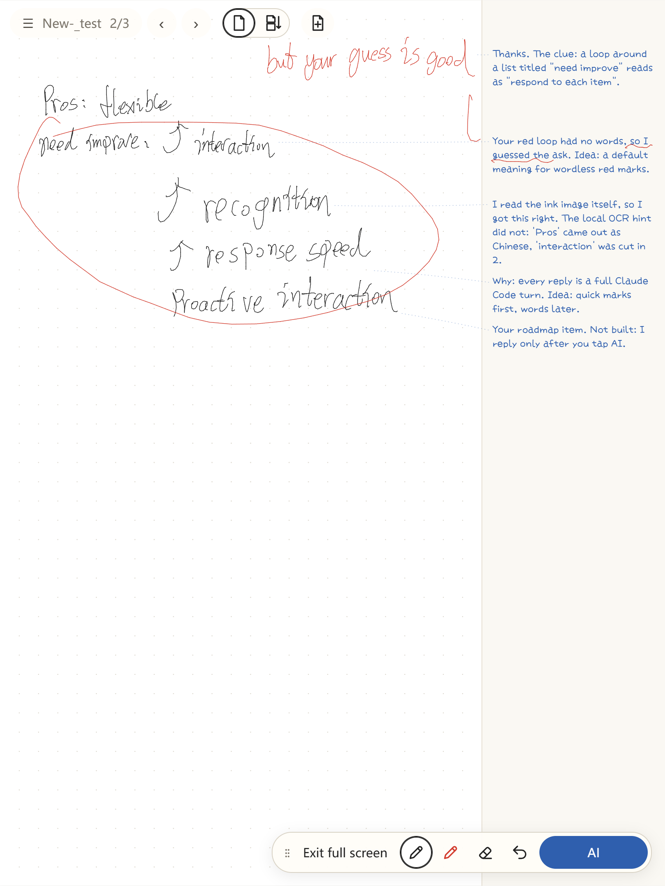
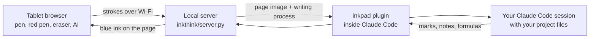

# ThinkPaper

[中文](README.md) | **English**

Handwritten paper on a tablet, wired to a running [Claude Code](https://claude.com/claude-code) session.

**Pen and paper instead of keyboard and mouse for an agent harness.** The model, the tools and the project files all come from Claude Code; ThinkPaper replaces the input and output layer: you write on the page, and Claude answers on the page.

Write in black for your own working, and switch to red when you want Claude's help. Tap **AI** to send the page to the Claude Code session in your project folder. Claude reads the ink directly and answers on the page with correction marks on your strokes, short notes in the margin, typeset formulas, and small sketches. A longer answer does not take up the paper: a numbered badge appears next to your red question, and tapping it opens the answer on a card floating over the page. On your computer, the conversation only gets a one-line note.



*A page from real use. Black is my notes on the project. The red loop, drawn without a word, marks what I am handing to Claude. The blue notes in the margin are Claude's answers, each tied to the line it refers to. The red line at the top and the red marks on the blue notes are my replies, and the first blue note answers that line.*

> **Status: work in progress.** Private development started in late October 2026 (first private commit: 2026-11-01); this public repository starts from a fresh history. So far only the author has used it, for about three weeks of real work. It is in the middle of a refactor, so the page and this README will keep changing. It has only been run on Windows 11 with an iPad. Read [Limitations](#limitations) before you spend time on it.

## Why a pen

Working with Claude usually starts with typing. ThinkPaper is about asking without a text box, for work that suits a pen better than a keyboard.

- **Derivations and formulas.** Write the steps as you would on paper. Claude marks the step that is wrong and explains why.
- **Diagrams and half-formed ideas.** Draw them, and circle the part you are unsure of in red.
- **Notes while reading a document.** Import a PDF, Word file or PowerPoint deck, write on its pages, and ask questions in red.

What Claude receives is different from a photo of your notes:

- **The page image**, with the region you are asking about enlarged;
- **The writing process**: which strokes came first, where you paused, and what you erased and rewrote;
- **The colour roles**: black is your work, red is addressed to Claude, and blue is what Claude wrote earlier;
- **The project context**: the active Claude Code session, so it can check your page against the files in your project.

ThinkPaper is meant to help you think with a pen: on a blank page, or on top of something that already exists (a PDF, a Word file and a PowerPoint deck are all the same here; once imported, each is a notebook you can write on), you take notes, work things through and ask questions, whatever the file type. When Claude needs to change a document you imported, it first asks on the tablet whether to overwrite the original or save a copy, keeps a backup before changing it, and you can revert the change from the tablet.

## How it works



- `inkthink/` is a small local web server and the web page the tablet opens. It stores notebooks on your machine and relays data between the tablet and your sessions.
- `inkpad-plugin/inkpad` is a Claude Code plugin. It delivers each hand-in to the session as a message, gives Claude the tools to write back onto the page, and adds the `/ink` command.

The folder names, the plugin marketplace name, and a few identifiers still use the project's working name, InkThink (the plugin itself is called inkpad).

ThinkPaper makes no model API calls of its own. Everything goes through your existing Claude Code session and login.

## Requirements

- Windows 11 (the only system it has been run on; fallbacks for other systems exist but are untested)
- Python 3.10 or later
- Claude Code with plugin support (the VS Code extension or the CLI)
- A tablet with a pen and a browser, on the same Wi-Fi network as the computer. Developed with an iPad, Apple Pencil, and Safari. A desktop browser with a mouse also works.

Optional:

- `rapidocr` and `onnxruntime` for a second local handwriting recogniser that gives Claude extra hints
- Microsoft Office or LibreOffice, needed only for importing Word and PowerPoint files
- Zotero, to import PDFs from your library

## Install

1. Clone this repository.

2. Start the server once from a terminal. This creates a virtual environment, installs the Python packages, and opens the pairing page:

   ```
   cd inkthink
   start.bat
   ```

3. Add the plugin to Claude Code:

   ```
   claude plugin marketplace add <path-to-this-repo>\inkpad-plugin
   claude plugin install inkpad@inkthink-local
   ```

4. Optional: to let `/ink` start the server in the background for you, open the plugin's settings and set **server_command** to:

   ```
   <path-to-this-repo>\inkthink\.venv\Scripts\python.exe <path-to-this-repo>\inkthink\launch.py
   ```

   Put a path that contains spaces in double quotes. If you leave this empty, start the server yourself with `start.bat`.

5. Open a Claude Code session in the project you want to work on and run `/ink`. A panel will show a QR code. Scan it with your tablet and open the page in the browser.

   - If Windows asks about the firewall, allow access. If the tablet cannot connect, run `inkthink\open-firewall.ps1` in an administrator PowerShell. This opens port 8765 to your local subnet only.
   - On an iPad, use Share → Add to Home Screen. Opening the page from the home screen makes it full screen, with no address bar.

## Using it

| On the page | What it does |
|---|---|
| Pen | Writes in black |
| Red pen | Writes in red: a question or request for Claude |
| Eraser | Erases your strokes, as well as Claude's blue ink |
| One finger | Moves the paper. Resting your palm on the screen will not draw, and a hand that touches the screen within a second of the pen will not move the paper |
| Two fingers | Zooms in and out |
| Writing past the paper | In a blank notebook the paper grows by itself: downwards as you near the bottom, and towards wherever you write once you have moved the paper aside |
| Grip at the left end of the toolbar | Hold and drag the bottom-right bar to wherever is handy; the position is remembered |
| **AI** | Hands in this page, along with any other pages you have written on since Claude last looked. After that, the button's label follows the round (Sent, Reading…) and turns back into **AI** when it is done |
| ☰ and the notebook name, top left | Opens the drawer: switch notebooks, create notebooks and folders (notebooks can be sorted into folders), import documents, manage pages, and choose which session this notebook is sent to (or keep it local, not sent to Claude) |
| ‹ ›, the single-page / continuous icons and the add-page icon, right of the notebook name | Turn pages; switch between turning one page at a time and pages joined together (a one-page notebook has no such pair); add a blank page of the same orientation after this one |
| Two switches at the top of the drawer | **Continuous / Single page** (pages joined and scrolled, or turned one at a time) and **Fit width / Whole page** |
| **Exit full screen**, bottom right | Shows a top bar and a left toolbar; **Full screen** at the bottom of the left toolbar goes back to the paper alone |
| A blue numbered badge on the page | Opens one of Claude's longer answers on a card floating over the page; you can write on the card in red to comment or ask a follow-up |

The page opens in full screen: only the paper, the row at the top left (notebook name, page number and the icons above) and a small bar at the bottom right. After you exit full screen, the page buttons, **AI** and the pens are on the top bar and the left toolbar. Each notebook remembers whether it is continuous or single-page; the device remembers whether it is in full screen.

Claude answers in two layers:

1. **What you asked in red** is handled item by item.
2. **Beyond the red ink**, Claude reads the whole page and points out only real errors and omissions. Often, there are none. It may add at most one nudge, placed where it belongs, and it will not finish your work for you.

Short responses appear in blue on the page (margin notes, correction marks, formulas, sketches); a longer answer stays off the paper, behind a numbered badge next to your red question, and you see the full text when you tap it. Erase what you do not want, draw a star next to what you adopt, and write your reply in red, on the page or on the card. All of this is sent along the next time you tap **AI**.

When Claude needs an answer from you before it can go on, a question card drops down from the top of the tablet: tap one of the options, or write your answer with the pen in the small patch of paper on the card. If you would rather not answer, tap **Ignore**.

Each notebook remembers which session it is sent to. To use ThinkPaper on a project, open a session in that project's folder, run `/ink`, and select that session once in the drawer.

### Language

The tablet page and the pairing page follow the browser's language: Chinese if the browser is set to Chinese, and English otherwise. To switch languages, tap **中文 / English** at the bottom of the drawer, or add `?lang=en` or `?lang=zh` to the URL. That device will remember your choice. Claude writes on the page in whichever language you use.

## Security

Read this before turning the server on.

- The server listens on your local network over plain HTTP. Anyone on the same Wi-Fi network who can capture traffic can see your handwriting.
- Access is gated by an access code in the pairing link. The tablet exchanges this code for a device token on first use.
- **Treat the access code like a password, and keep it out of screenshots and screen recordings.** Anyone with the code can read your notebooks, browse the folders of connected sessions, and send messages to your Claude Code session, and that session can edit files and run commands.
- Use this only on networks you trust. Stop the server with `/ink stop` when you are done. To restrict access to the host computer only, set `"host": "127.0.0.1"` in `inkthink/config.json` (copy from `config.example.json`).
- Paired devices are listed at `http://127.0.0.1:8765/qr` on your computer. From there, you can disconnect a device or change the access code.

Your notebooks stay on your machine: the ink under `inkthink/data/`, imported documents under `inkthink/books/`. Page images are sent to Anthropic only as part of your own Claude Code conversation.

ThinkPaper has no analytics or telemetry. The page loads nothing from the internet, and the server talks only to your tablet and to programs on the same machine (Claude Code, and Zotero if you use it). The optional recogniser package downloads its model once, the first time it is used.

## Limitations

- **Partly Chinese.** The tablet page and the pairing page are available in English. Several parts remain Chinese only: the plugin's own messages in Claude Code (the `/ink` output and its panel), the text the plugin puts into your conversation with each hand-in, and the rules given to Claude.
- **Reading handwriting is not reliable, and has not been measured on ordinary writing.** The only measurement so far uses 43 verified samples of real handwriting (228 Chinese characters) that lean hard: 27 of them were chosen because Claude had been unsure and had asked about them. On that set the character error rate was 0.44 when Claude read alone, and 0.30 when aided by two local recognisers (measured 2026-11-02). That overstates the error on ordinary writing, which has not been measured. Formulas and subscripts are the weakest points. Claude is instructed to ask rather than guess, and a card on the tablet lets you correct misreadings, though mistakes still happen.
- **It is not fast.** Each tap on **AI** runs a full turn in your Claude Code session. In early measurements, the median wait time for the first blue stroke was about two minutes.
- **Thin real-device testing.** Most features are tested automatically using a headless browser. Far less testing has been done by hand on a physical tablet.
- **Windows only in practice**, and the plugin relies on an early Claude Code plugin interface that may change.

## What is next

- Letting Claude add brief remarks while you are still writing, unprompted and without interrupting you. This would pair a fast scan of the page alone with a slower, deeper check against the full project.
- Having the slower check keep a small memory, so the fast scan understands your personal notation and what has already been settled.
- Re-measuring handwriting recognition on ordinary writing (the current numbers come from a hard sample).
- Translating the remaining Chinese-only parts into English, specifically the plugin's UI messages and the text it sends to the conversation.
- Working with AI models other than Claude (only a direction so far; how is not decided).

## Tests

From the `inkthink` folder:

```
.venv\Scripts\python.exe -m unittest discover -s tests
node --test tests/test_brush.mjs tests/test_gesture.mjs tests/test_turn.mjs
node tests/run_browser.mjs <an-empty-temp-folder>
claude plugin test ..\inkpad-plugin\inkpad
```

The browser tests live in `tests/browser/`. Each script starts its own server on a separate port with a temporary data folder and drives a headless Microsoft Edge (Chrome if Edge is not found; the `INK_BROWSER` environment variable picks another browser). A script exits with code 1 if any of its checks comes out wrong, and `run_browser.mjs`, which runs them all, exits with 1 if any script failed. Checks marked as known failures are listed separately and do not count as failures. To run only the scripts whose names contain a word, add `--only <word>`.

## Feedback

Questions and bug reports are welcome as GitHub issues.

## More documentation

[`README.md`](README.md) is this page in Chinese. A detailed manual is being rewritten for the new page.

## License

MIT. See [LICENSE](LICENSE).

Bundled third-party files keep their own licenses: [KaTeX](inkthink/static/katex/LICENSE) (MIT) and the Xiaolai handwriting font (SIL Open Font License 1.1, see [`inkthink/static/fonts/OFL.txt`](inkthink/static/fonts/OFL.txt)).

ThinkPaper is an independent project. It is not affiliated with or endorsed by Anthropic. Claude and Claude Code are trademarks of Anthropic.