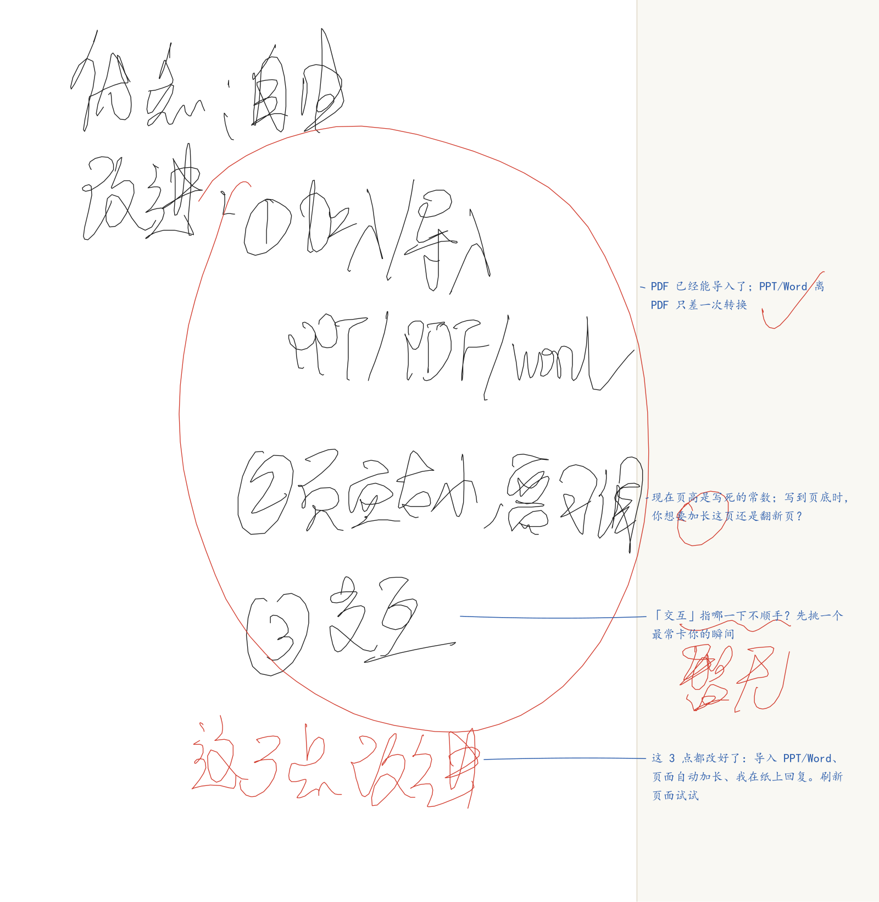

# ThinkPaper 草稿纸

**中文** | [English](README.en.md)

平板上的手写草稿纸，直连电脑上正在进行的 [Claude Code](https://claude.com/claude-code) 对话。

**用平板和电子手写笔（像纸笔那样写）代替键盘和鼠标来使用 agent harness。** 模型、工具和项目文件都来自 Claude Code；ThinkPaper 换掉的是输入和输出这一层：你写在平板的这张纸上，Claude 也回在这张纸上。

平时用黑笔书写推演，需要与 AI 交流时换红笔。点一下「AI」，当前页就会发往项目目录下的那个 Claude Code 对话。Claude 直接读取墨迹，并把蓝字回答写回纸上：在你的笔迹上打批改符号、在旁边写简短批注，还会附上排好版的公式和小示意图；较长的回答不占纸面，只在红笔问题旁标一个圈号，点开是一张浮在纸上的卡片。电脑端的对话窗口里则只留下一句简短记录。



*实际使用案例：黑字是关于项目的思考笔记；红笔是圈出并提给 Claude 的内容；页边蓝字是 Claude 的回答，各用细线连回对应行；蓝字上的红字则是我的进一步回应。*

> **现状：仍在开发中。** 项目从 2026 年 10 月下旬开始私下开发（首次私有提交于 2026-11-01），本公开仓库的提交历史是从头开始的。目前只有作者一人在实际工作中用了约三周，且正处于重构中途，页面和这份说明还会继续变动。目前仅在 Windows 11 + iPad 环境下跑过。决定投入时间前，请先阅读[局限](#局限)。

## 为什么用笔

和 Claude 协作通常从打字开始。ThinkPaper 做的是省去输入框，专门处理那些用笔比敲键盘更适合的事：

- **推导和公式。** 像在真纸上一样一步步写，由 Claude 标出出错的那一步并说明原因。
- **示意图和没想清楚的想法。** 直接画出来，拿不准的地方用红笔圈起来。
- **读文档时的笔记。** 导入 PDF、Word 或 PowerPoint，直接在页面上写画，用红笔提问。

发给 Claude 的不只是一张页面截图，还包括：

- **页面图像与局部放大**：整页图像，以及你提问区域的局部放大图；
- **书写过程**：先写了哪几笔、在哪里停顿、擦掉又重写了什么；
- **颜色分工**：黑色是你的推导与笔记，红色是写给 Claude 的话，蓝色是 Claude 之前写下的内容；
- **项目上下文**：当前连接的 Claude Code 对话上下文，因此它能直接对照项目里的文件来核对这一页。

ThinkPaper 想做的是用手写笔帮你思考：无论是在空白纸上，还是在已有文档上（PDF、Word、PowerPoint 导入后都统一变成可手写的本子），都能以同样的方式记笔记、推导和提问，不按文件类型区分。当 Claude 需要修改你导入的文档时，会先在平板顶部问你是覆盖原文件还是另存一份；修改前会自动留底，改得不满意可以在平板上撤回。

## 它是怎么工作的


- `inkthink/` 是一个轻量的本机网页服务，托管平板打开的页面。本子保存在你自己的电脑上，服务负责在平板和各个对话之间转发数据。
- `inkpad-plugin/inkpad` 是 Claude Code 插件。它负责把每次提交的页面作为消息发进对话，给 Claude 提供写回纸面的工具，并注册 `/ink` 命令。

文件夹名、插件市场名和少数内部名称仍保留着项目原来的名字 InkThink（插件本身叫 `inkpad`）。

ThinkPaper 本身不调用任何模型接口，所有请求都走你正在使用的 Claude Code 对话和登录状态。

## 需要什么

- Windows 11（目前仅在它上面跑过；代码中为其他系统留了后备方案，但尚未测试）
- Python 3.10 或更高版本
- 支持插件的 Claude Code（VS Code 扩展或命令行均可）
- 一台配手写笔、带浏览器的平板，与电脑连在同一个 Wi-Fi 下。开发时用的是 iPad、Apple Pencil 和 Safari；直接用电脑浏览器加鼠标也能跑。

可选依赖：

- `rapidocr` 和 `onnxruntime`：多加一层本地手写识别，给 Claude 当参考旁证
- Microsoft Office 或 LibreOffice：仅在导入 Word、PowerPoint 时需要
- Zotero：用于从文献库直接导入 PDF

## 安装

**一步安装（只支持 Windows）**：克隆本仓库后，双击仓库根目录的 `install.bat`。它会找到 Python（3.10 或更新）、建虚拟环境并安装依赖、安装并配置插件、检查防火墙（需要放行时会请你确认一次），最后启动服务并打开配对二维码页。每一步都会写出结果，做过的步骤再运行时会跳过；想先看它会做什么而不做任何改动，在仓库文件夹里打开命令行，运行 `.\install.bat --dry-run`。装好后重开 Claude Code，再从下面第 5 步接着做。各步的细节见详细手册 [`inkthink/README.md`](inkthink/README.md) 的「安装」一节。

**手动安装**：

1. 克隆本仓库。

2. 在终端里手动启动一次服务。脚本会自动创建虚拟环境、安装 Python 依赖包，并打开配对二维码页面：

   ```
   cd inkthink
   start.bat
   ```

3. 把插件加进 Claude Code：

   ```
   claude plugin marketplace add <仓库所在路径>\inkpad-plugin
   claude plugin install inkpad@inkthink-local
   ```

4. （可选）配置 `/ink` 自动在后台启动服务：在插件设置里将 **server_command** 填为

   ```
   <仓库所在路径>\inkthink\.venv\Scripts\python.exe <仓库所在路径>\inkthink\launch.py
   ```

   路径里有空格时请用双引号括起来。如果留空，每次手动运行 `start.bat` 启动即可。

5. 在目标项目里打开一个 Claude Code 对话，执行 `/ink`。面板上会弹出二维码（命令行版的面板只显示地址，二维码在电脑浏览器里打开 `http://127.0.0.1:8765/qr` 可以看到），用平板扫码并在浏览器中打开。

   - Windows 弹出防火墙提示时请点允许。如果平板连不上，请在管理员 PowerShell 中运行 `inkthink\open-firewall.ps1`（仅对本地子网开放 8765 端口）。
   - 在 iPad 上可以用「分享 → 添加到主屏幕」，从主屏幕打开即为无地址栏的全屏效果。

## 怎么用

| 页面元素与手势 | 作用 |
|---|---|
| 笔 | 写黑字（日常推导与笔记） |
| 红笔 | 写红字（留给 Claude 的问题或要求） |
| 橡皮 | 擦除你的笔迹，也能擦掉 Claude 的蓝字 |
| 单指拖动 | 移动纸面。支持防误触：手掌搭在屏幕上不会落墨；停笔后一秒内碰到屏幕的手也不会挪动纸面 |
| 双指捏合 | 缩放页面 |
| 写到纸面边缘 | 空白本子的纸会自动延展：快写到页底时自动往下长；把纸挪开后写在边界外，纸面就会向落笔方向扩展 |
| 工具条左端的把手 | 按住可将右下角的悬浮工具条拖到顺手的位置，位置会自动记住 |
| **AI** | 提交当前页（自 Claude 上次查看后动过笔的其他页也会一并提交）。提交后按钮文字会随进度变化（已交、Claude 在看……），结束后变回「AI」 |
| 左上角的 ☰ 和本子名 | 打开侧边抽屉：切换本子、新建本子和文件夹、导入文档、管理页面，以及选择当前本子发往哪个对话（也可设为仅保存在本地、不发给 Claude） |
| 本子名右边的 ‹ ›、单页/连续图标、加页图标 | 翻页；切换「单页翻页」或「上下连页滚动」（只有一页的本子不显示前两项）；在当前页后插入一张同方向的空白页 |
| 抽屉最上面的两组开关 | 切换 **连续 / 单页**（上下连页滚动或逐页翻阅）与 **适配宽度 / 整页** 视图 |
| 右下角的「退出全屏」 | 展开顶栏和左侧工具栏；之后点左侧最下方的「全屏」可回到纯纸面模式 |
| 纸上的蓝色圈号 | 点开是 Claude 的长回答卡片（浮在纸面上）；可以直接用红笔在卡片上批注、追问 |

页面默认以全屏模式打开：只保留纸面、左上角状态栏（本子名、页码和快捷图标）以及右下角的悬浮工具条。退出全屏后，翻页、「AI」和画笔工具会分布在顶栏和左侧工具栏上。「连续 / 单页」模式由每个本子各自记住；是否全屏则记在当前设备上。

Claude 的回应分两层：

1. **红笔写的内容**：逐条处理。
2. **红笔之外的部分**：通读整页，只指出真正的错误和遗漏（没有问题就一条也不写）。它最多在合适的位置补一句点拨，不会替你把内容写完。

简短的回应用蓝字直接写在纸上（短批注、批改符号、公式、示意图）；长回答不上纸，收在红笔问题旁的蓝色圈号里，点开才显示全文。不需要的批注可以用橡皮擦掉，打算采纳的可以在旁边画个星号，想继续追问就用红笔写在纸上或卡片上——这些反馈都会在下一次点「AI」时一并带给 Claude。

当 Claude 需要你确认信息才能继续时，会在平板顶部落下一张提问卡片：可以直接点选选项，或用笔写在卡片自带的小纸条上；不想回答可以点「忽略」。

每个本子都会记住自己发往哪个对话。要在某个项目里使用，只需在该项目文件夹下开一个对话并执行 `/ink`，然后在侧边抽屉里选一次这个对话即可。

### 语言

平板页面和配对页默认跟随浏览器语言：浏览器是中文就显示中文，否则显示英文。如需手动切换，可点击抽屉最下方的「中文 / English」，或者在网址末尾加上 `?lang=zh`、`?lang=en`，当前设备会记住这个设置。Claude 写在纸上的语言则会与你下笔的语言保持一致。

## 安全

使用前请先读完这一节。

- 服务在局域网内监听，走的是明文 HTTP。同一个 Wi-Fi 下如果有别人抓包，能看到你的笔迹。
- 身份验证靠配对链接里的访问码。平板首次打开链接时，会用访问码换取一个仅限该设备使用的令牌。
- **请把访问码当成密码保管，截图和录屏时注意避开。** 别人一旦拿到访问码，就能查看你的本子、浏览已连接对话所在的文件夹，还能往你的 Claude Code 对话里发消息——而那个对话有权限改文件、跑命令。
- 请只在受信任的网络中使用，不用时执行 `/ink stop` 停掉服务。如果只想在电脑本机访问，可以在 `inkthink/config.json` 里加上 `"host": "127.0.0.1"`（可从 `config.example.json` 复制一份修改）。
- 已配对的设备列在电脑端的 `http://127.0.0.1:8765/qr` 页面上，在那里可以随时断开某台设备或重置访问码。

所有本子都保存在你自己的电脑上：笔迹在 `inkthink/data/`，导入的文档在 `inkthink/books/`。页面图像只会作为你自己的 Claude Code 对话内容发给 Anthropic。

ThinkPaper 不做任何统计和上报。前端页面不从互联网加载任何内容；本地服务只与你的平板、以及同一台电脑上的程序（Claude Code，用到的话还有 Zotero）通信。可选的本地识别包在第一次使用时会下载一次模型。

## 局限

- **部分界面只有中文。** 平板页面和配对页支持中英文。目前还只有中文的地方包括：插件在 Claude Code 里的提示（`/ink` 的输出和面板）、每次提交时放进对话的那段文字，以及给 Claude 的规则说明。
- **手写识别还不可靠，而且未在日常字迹上测过。** 现有的唯一一次测试用的是 43 组人工核对过的真实手写样本（共 228 个汉字）。这批样本偏难，其中 27 组是 Claude 当时拿不准、弹卡片问过的。在这批样本上，Claude 单独认字的字符错误率是 0.44，加上两种本地识别做旁证后降到 0.30（2026-11-02 测试）。这比日常字迹上的错误率要高，而日常字迹还没有正式测过。目前公式和下标的识别最弱。虽然规则要求 Claude「拿不准就问、不要猜」，平板上也有卡片方便你纠正读法，但认错字的情况还是会有。
- **响应不快。** 每次点「AI」，背后都是 Claude Code 对话里完整的一轮交互。早期实测，从提交页面到纸上出现第一笔蓝字，中位数耗时约两分钟。
- **真机测试较少。** 大部分功能靠无头浏览器跑自动化测试，在真实平板上手动测过的场景少得多。
- **目前实际上只支持 Windows**，而且插件依赖的是 Claude Code 早期的插件接口，后续可能会变动。

## 接下来

- 让 Claude 在你书写的过程中主动补一句简短提示，不用手动点，也不用停笔：分两层跑，快层只看当前页、反应快；慢层结合整个项目、看得慢但更细。
- 由慢层维护一份小型记忆，让快层也能记住你的个人记号和已经敲定的结论。
- 用日常字迹重新测一遍认字准确率（现有数据来自偏难的样本）。
- 给目前还只有中文的部分补齐英文。
- 适配 Claude 以外的 AI（目前只是方向，具体做法还没定）。

## 测试

进入 `inkthink` 文件夹执行：

```
.venv\Scripts\python.exe -m unittest discover -s tests
node --test tests/test_brush.mjs tests/test_gesture.mjs tests/test_turn.mjs
node tests/run_browser.mjs <一个空的临时文件夹>
claude plugin test ..\inkpad-plugin\inkpad
```

浏览器测试位于 `tests/browser/` 下。每个脚本各自在独立端口上用临时数据目录启动服务，调用无头模式的 Microsoft Edge（找不到时用 Chrome，也可以用环境变量 `INK_BROWSER` 指定）完成测试；只要有一项检查未通过，该脚本就以 `1` 退出。`run_browser.mjs` 会把它们全跑一遍，有一个没过，整次运行也以 `1` 退出；标着「已知不过」的项会单独列出，不算失败。若只跑名字里带某个词的测试，可在命令后面加 `--only <词>`。

## 反馈

问题和建议请在 GitHub 上提 issue。

## 更多说明

详细手册见 [`inkthink/README.md`](inkthink/README.md)。

## 许可证

MIT，详见 [LICENSE](LICENSE)。

随仓库附带的第三方文件保留各自的许可证：[KaTeX](inkthink/static/katex/LICENSE)（MIT）和小赖手写字体（SIL Open Font License 1.1，见 [`inkthink/static/fonts/OFL.txt`](inkthink/static/fonts/OFL.txt)）。

ThinkPaper 是独立的个人项目，与 Anthropic 没有任何关联，也未获得其官方认可。Claude 和 Claude Code 是 Anthropic 的商标。
