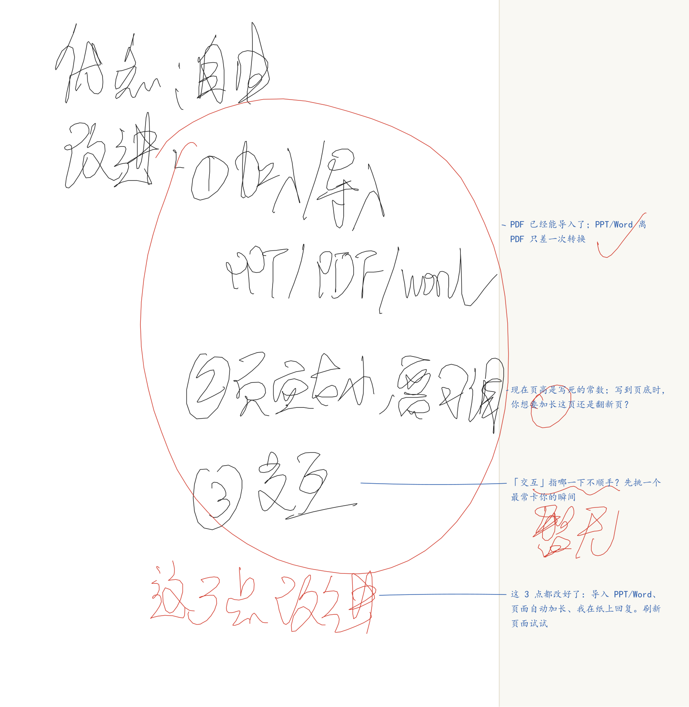

# ThinkPaper 草稿纸使用手册

这份手册讲怎么安装、怎么连上平板、一页纸怎么用、Claude 会怎么回、东西存在哪、出了问题怎么办。ThinkPaper 是什么、为什么用笔，见仓库根目录的[说明](../README.md)。

手册按现在的页面写。项目还在开发中，页面会继续变；手册和你看到的对不上时，以页面为准。

## 目录

- [它是什么](#它是什么)
- [需要什么](#需要什么)
- [安装](#安装)
- [第一次连上平板](#第一次连上平板)
- [一页纸怎么用](#一页纸怎么用)
- [点「AI」之后](#点ai之后)
- [Claude 怎么回](#claude-怎么回)
- [Claude 问你](#claude-问你)
- [本子和页](#本子和页)
- [在已有的文件上写](#在已有的文件上写)
- [让 Claude 改文件](#让-claude-改文件)
- [每本发往哪个对话](#每本发往哪个对话)
- [接别的 AI（试验）](#接别的-ai试验)
- [新文件提示、Claude 的读法、新手引导](#新文件提示claude-的读法新手引导)
- [导出和备份](#导出和备份)
- [设置和语言](#设置和语言)
- [数据存在哪](#数据存在哪)
- [出了问题](#出了问题)
- [现在的限制](#现在的限制)

## 它是什么

ThinkPaper（页面上叫「草稿纸」）把平板变成一张能手写的纸，接到你电脑上正在进行的某个 Claude Code 对话上。你用黑笔写自己的推导和笔记，用红笔写想让 Claude 办的事，写完点「AI」，这一页就作为一条消息交进那个对话。Claude 带着这个对话的上下文和项目里的文件读它，再用蓝字回在纸上。

它由两部分组成：电脑上的一个小网页服务（仓库里的 `inkthink` 文件夹，平板打开的页面也由它提供），和 Claude Code 的插件 inkpad（`inkpad-plugin` 文件夹）。它自己不调用任何模型接口，用的是你自己的 Claude Code 对话和登录。文件夹名和少数地方还留着项目原来的名字 InkThink。

现状：只在作者自己的 iPad 和一台 Windows 11 电脑上用过，只支持 Windows，别的平板、别的浏览器都没试过。这是一个使用 Claude Code 的第三方个人项目，和 Anthropic 没有关系。

## 需要什么

- 一台 Windows 电脑。只支持 Windows；作者用的是 Windows 11。
- Python 3.10 或更新的版本。从 python.org 安装时勾上「Add python.exe to PATH」。
- Claude Code，命令行版或 VS Code 扩展都可以。一步安装会自动填好插件的设置，这一步要 Claude Code 2.1.285 或更新的版本；版本旧的话，安装程序会告诉你手动填哪一行。
- 一台带浏览器和手写笔的平板，和电脑连同一个 Wi-Fi。作者用的是 iPad、Apple Pencil 和 Safari。想先看看是什么样，也可以在电脑浏览器里用鼠标打开。
- 安装时要联网：第一次要下载几十 MB 的 Python 包。

用得上再装的：

- Microsoft Office 或 LibreOffice：导入 Word、PowerPoint 时用它转成 PDF。只导入 PDF 和图片的话用不着。
- Zotero 7：想从文献库里直接导入 PDF 时用。
- 本机手写识别：识别结果只给 Claude 当旁证，没有也能用。Windows 自带的手写识别要装对应语言的手写包（设置 → 时间和语言 → 语言 → 中文或英语 → 手写）。另一种识别器 RapidOCR 可以另装：在 `inkthink` 文件夹里运行 `.venv\Scripts\python.exe -m pip install rapidocr onnxruntime`，第一次用时它会下载一次模型。

## 安装

### 一步安装

1. 把仓库下载到电脑上（`git clone`，或者在 GitHub 上下载 ZIP 解压）。放在哪都行，下面说的「仓库文件夹」就是它。
2. 双击仓库文件夹里的 `install.bat`。

它先找电脑上 3.10 或更新的 Python，找不到就提示你去 python.org 安装。找到以后按顺序做九步，每一步先说要做什么，再写结果：完成、跳过（已经做过）、注意，或者失败；失败的会写怎么补。做过的步骤再运行时会跳过，所以改好问题以后直接再双击一次就行。想先看它会做什么、什么都不改，在仓库文件夹里打开命令行，运行 `.\install.bat --dry-run`。

| 步骤 | 做什么 |
|---|---|
| 1. 确认 Python 版本 | 要 3.10 或更新。 |
| 2. 建环境 | 在 `inkthink\.venv` 建一个 Python 虚拟环境（只用它自己的包）。已经有了就不重建。 |
| 3. 装依赖 | 用 pip 装 `inkthink\requirements.txt` 里的包，要联网。装过、清单没变就跳过。 |
| 4. 找到 claude 命令 | 依次找：命令行里的 `claude`、官方安装程序和 WinGet 装的位置、VS Code 一类编辑器里 Claude Code 扩展自带的 `claude.exe`。只装了 VS Code 扩展的，先在 VS Code 里打开过一次扩展。 |
| 5. 登记插件市场 | `claude plugin marketplace add <仓库文件夹>\inkpad-plugin`。已经有一个同名（inkthink-local）但指向别的文件夹的，这一步不动它，报失败并说明怎么换。 |
| 6. 安装插件 | `claude plugin install inkpad@inkthink-local --scope user`，装在用户范围，每个项目的对话都能用。装过但被关掉的，重新打开。 |
| 7. 填好插件的启动命令 | 把插件设置里的「启动草稿纸服务的命令」填成 `<仓库文件夹>\inkthink\.venv\Scripts\python.exe <仓库文件夹>\inkthink\launch.py`。填了它，在对话里输入 `/ink` 时服务没在运行就会自动在后台启动。Claude Code 版本太旧或没填成时，它把这一行打出来、复制到剪贴板，告诉你在 Claude Code 里输入 `/plugin configure inkpad@inkthink-local` 贴进去。 |
| 8. 查防火墙 | 见下一段。 |
| 9. 启动服务、打开配对二维码页 | 在后台启动服务（已经在运行就不重复启动），在电脑浏览器里打开 `http://127.0.0.1:8765/qr`。 |

第 8 步：平板要通过局域网连电脑的 8765 端口。Windows 防火墙已经放行的，跳过。挡着的，安装程序先说明原因，然后弹一次管理员确认（Windows 的「用户账户控制」），只加一条规则「InkThink 8765 (LAN)」，只允许同一局域网里的设备连这个端口。点「否」也能装完，只是平板可能连不上，以后可以照「手动安装」第 6 步再加。如果查到有一条规则在挡 Python（多半是以前在 Windows 防火墙的弹窗里点了取消），它会提醒你：按 Win+R 输入 `wf.msc`，在入站规则里把名字是 python、带红色禁止图标的那条禁用。

最后一段写「装好了」或「没装完」。装好了就照它说的做：重开 Claude Code（新装的插件和改过的设置重开以后才生效；VS Code 里可以用命令面板的「Developer: Reload Window」），然后看下一节。安装程序不改 `inkthink\config.json`，也不动已有的数据。

以后更新：拉取新代码（`git pull`）后，先在二维码页上点「停止服务」，再双击 `install.bat`。服务开着的话它只是打开二维码页，跑的还是旧代码。

### 手动安装

一步安装不成时，照下面一条条做，这就是安装程序实际运行的命令。第 1、2、7 步在 `inkthink` 文件夹里打开命令行（PowerShell 或命令提示符）运行，别的在哪运行都行。`<仓库文件夹>` 换成你自己的路径，路径里有空格的，那一段用英文双引号括起来。

1. 建环境：`python -m venv .venv`
2. 装依赖：`.venv\Scripts\python.exe -m pip install -r requirements.txt`
3. 登记插件市场：`claude plugin marketplace add <仓库文件夹>\inkpad-plugin`
4. 安装插件：`claude plugin install inkpad@inkthink-local --scope user`
5. 填启动命令：在 Claude Code 里输入 `/plugin configure inkpad@inkthink-local`，把「启动草稿纸服务的命令」填成 `<仓库文件夹>\inkthink\.venv\Scripts\python.exe <仓库文件夹>\inkthink\launch.py`。不填也能用，只是每次要自己启动服务（第 7 步）。
6. 放行防火墙（要管理员权限）：右键「开始」→「终端（管理员）」，运行 `powershell -ExecutionPolicy Bypass -File "<仓库文件夹>\inkthink\open-firewall.ps1" -Port 8765`。它只放行同一局域网里的设备。以后不要了，在管理员终端里运行 `Remove-NetFirewallRule -DisplayName "InkThink 8765 (LAN)"`。
7. 启动服务：`.venv\Scripts\python.exe launch.py`。服务在后台运行，不占窗口，关掉 Claude Code 也不停，一直到关机或你停掉它。也可以双击 `inkthink\start.bat`：它在一个窗口里运行服务、打开二维码页，关掉窗口服务就停了；还没有环境时，它会先做第 1、2 步。
8. 重开 Claude Code。

### 卸载

1. 停掉服务：二维码页上点「停止服务」，或在对话里输入 `/ink stop`。
2. 卸插件：`claude plugin uninstall inkpad@inkthink-local`，再 `claude plugin marketplace remove inkthink-local`。
3. 去掉防火墙规则（见上面第 6 步）。
4. 删掉仓库文件夹。你的本子都在 `inkthink\data` 和 `inkthink\books` 里，要留的先挪走。

## 第一次连上平板

1. 在你要用的项目文件夹里开一个 Claude Code 对话，输入 `/ink`。服务没在运行时，它会在后台启动服务（要填好启动命令）。对话旁边会打开「手写草稿纸」面板，写着服务连上没有、平板在不在线、平板上开着的那本发往哪个对话；回复里写着平板该打开的地址。
2. 找二维码：VS Code 里的面板上有；命令行版的面板只写地址，这时在电脑浏览器里打开二维码页 `http://127.0.0.1:8765/qr`（只能在这台电脑上打开）。二维码页上第一个写着「先试这个（这次的 IP 地址）」，后面可能还有「上面那个打不开再试」；电脑名是英文字母和数字时，另有一个「固定地址」（电脑名加 `.local`），换了网络、IP 变了也能用，但有的网络不支持。
3. 平板和电脑连同一个 Wi-Fi，用平板的相机扫二维码，在浏览器里打开。第一次打开时 Windows 可能弹出防火墙提示，点允许。
4. 打开后你看到的是一整屏白纸，左上角写着「草稿本」，右下角是一条工具。这就连上了。

地址里 `k=` 后面那一段叫访问码，是服务第一次启动时随机生成的。平板第一次用带访问码的地址打开时，会用它换一个只属于这台设备的凭据（叫配对），之后都用这个凭据，访问码不留在平板上。页面上出现「需要访问码」时，扫一次新的二维码，或者把访问码输进去点「进入」。

在 iPad 上可以用 Safari 的「分享 → 添加到主屏幕」，以后从主屏幕的图标打开，没有地址栏，整屏都是纸。从主屏幕打开的页面可能要再配对一次，二维码页的设备列表里它的名字后面带「（主屏幕）」；那时访问码已经换过的话，输入新的访问码。

二维码页下面是「设备与安全」：列出配对过的设备、各自最近什么时候从哪个地址连过。「断开」一台设备会同时换访问码（它可能还记着旧地址），你别的设备照常用；「更换访问码」之后新设备要扫新的二维码，已配对的不受影响；「停止服务」停掉服务，插件也不会再自动把它拉起来，直到你下次输入 `/ink`。

请把访问码当密码看待。拿到它（或者一台已配对的设备）的人能看你的本子、浏览已连上的对话所在的文件夹、往你的 Claude Code 对话里发消息，而那个对话能改文件、跑命令。要注意的几处：

- 服务在局域网里用明文 HTTP，同一个 Wi-Fi 上有人抓包就能看到笔迹。只在信任的网络里用，用完可以 `/ink stop`。
- 访问码在二维码的地址里，也在 `/ink` 的回复里，平板浏览器的地址栏里可能也带着。截图、录屏、分享对话记录时避开它。
- 只想在电脑本机上用：在 `inkthink\config.json` 里写 `"host": "127.0.0.1"`（可以照 `config.example.json` 复制一份改），重启服务。

## 一页纸怎么用

### 三种颜色

- 黑笔：你自己的推导、笔记、草图。Claude 读，但不会把它当成交办的事。
- 红笔：明确要 Claude 办的事。问题、要求都行，比如「这一步对吗？」「只给提示」「帮我把这几行整理成要点」「画个示意图」。
- 蓝色：Claude 写回来的。

写的时候 Claude 不出声，点了「AI」才回。

### 按钮

页面打开时是「全屏」的样子：只有纸，左上角一排，右下角一条。

| 位置 | 按钮 | 做什么 |
|---|---|---|
| 左上角 | ☰ 本子名 页码 | 点 ☰ 或本子名打开左边的抽屉（本子、页面、导入、发往哪个对话）；点页码（圈着细框的「3/12」）出输入页码的小框，见下面。只有一页时不写页码。 |
| 左上角 | ‹ › | 上一页、下一页。这本不止一页才有。 |
| 左上角 | 单页、连续（一对图标） | 一页一页翻，还是上下页接在一起往下滑。当前的那个加框，点哪个就是哪个。这本不止一页才有。 |
| 左上角 | 加页图标 | 在这一页后面加一张和它同方向的空白页，并翻过去。 |
| 右下角 | 把手 ⋮⋮ | 按住把这一条拖到顺手的地方，位置记在这台设备上。 |
| 右下角 | 退出全屏 | 换成有顶栏和左侧工具栏的样子。 |
| 右下角 | 黑笔、红笔、橡皮、套索、撤销、恢复 | 见下面。 |
| 右下角 | 讲清楚 ▾（「AI」左边） | 回答要多长：点开选「点一下」「讲清楚」「展开讲」，见「回答要多长」。钮上写着现在这一档。 |
| 右下角 | AI | 把这一页交给 Claude，见「点「AI」之后」。 |

点「退出全屏」以后，顶栏上是 ☰、本子名、‹ 页码 ›、单页 / 连续、加页、回答要多长（「讲清楚 ▾」）、「AI」和「⋯」菜单；左侧工具栏是黑笔、红笔、橡皮、套索、撤销、恢复，最下面是「全屏」。「⋯」菜单只在这个样子下有（其中「Claude 读到了什么」和「再看一遍新手引导」在抽屉最下面也有）。全屏与否记在这台设备上。点「全屏」时，浏览器支持的话会把浏览器自己的界面也藏起来；这时屏幕最顶上那一条归浏览器（碰到会退出浏览器的全屏），那里落笔不算。

图标按钮上没有字，拿不准是什么时用手指长按一下，屏幕上会提示它是做什么的，这次松手不会触发它。

点页码（全屏时左上角圈着细框的「3/12」，退出全屏后顶栏上 ‹ › 中间那个）在它下面出一个小框：输一个页码，点「去」或按回车，翻到那一页；平板上弹出的是数字键盘，小框在屏幕上方，键盘挡不住。输的数不在 1 到总页数之间时，框里说一句，不翻。从别处跳过来的（点「别的页有新回答」的记号或它的小单子，卡片里的上一条、下一条翻到了别的页，在这个框里输页码跳的，提示里点「去看看」翻到这本别的页的），框里多一行「回到第 N 页」，N 是跳之前的那一页（插页、挪页以后也对得上），点了回去；回去也算一次跳，之后框里是回到刚才那一页。只有一页的本子点页码不出这个框。点框外面、再点一下页码或按 Esc 收起。

### 笔、橡皮、撤销和恢复

- 黑笔、红笔：点一下换笔。笔的粗细、样子是固定的，现在没有调节。
- 橡皮：一笔只擦一种东西，先碰到哪种擦哪种。先碰到你的字，就只擦你的字，旁边 Claude 的蓝字不动；先碰到蓝字，就把碰到的那一条蓝字整条擦掉，不碰你的字。带橡皮键的笔，按着橡皮键写就是擦。
- 套索（橡皮旁边那个虚线圈）：把自己写的几笔挪到别处，推导时腾地方。选了它，用笔在纸上画一圈，画的时候是一条细虚线，抬笔自动闭合；圈里没擦掉的黑笔、红笔笔迹被选中（一笔的点有一半以上在圈里才算），外面出一个虚线框，笔迹本身的样子不变。用笔按住框里拖，这几笔跟着走，抬笔定下，可以接着再拖；挪得很少（不到约 4 个屏幕像素）算没挪。点框外面、再画一圈、换工具、翻页、换本子、点「AI」、撤销或恢复都会取消选中；什么都没圈到就什么都不发生。只能挪，不改颜色、不删（删用橡皮）。Claude 只指着这几笔的东西跟着一起挪：短批注和小蓝点、圈号、摊在纸上的长回答（连同细线）、批改符号、圈、下划线、两头都在里面的箭头和连线、概念图上的建议；箭头和概念图上建议的连线只有一头指着这几笔的（另一头指着没选中的字，或者没指着你的字），这一头跟着走、另一头不动，线跟着变斜、变长，上面的关系词（连线的还有 ✓ × 钮）跟着线的中段；还指着别的笔迹的、指着书页上印刷文字或某一块地方的、示意图、图和公式留在原处。「Claude 读到了什么」的小灰字跟着那组字走；一组字只挪了一部分时，这组的读法先不显示，等 Claude 下次交来新的。一次挪动是撤销的一步，撤销回到挪之前（笔迹和跟着走的蓝字都回去），点「恢复」再挪过去。不跨页（连续模式下只在当前这一页里选、拖不出这一页）；书页和推送页上挪不出纸边，跟着走的蓝字也算在里面；书页、推送页右边那一栏里的短批注例外：它不左右挪，留在那一栏里，只跟着上下走，细线连到这几笔的新位置。它从原来的高度上下挪同样的量，到离纸的上下边一点为止；那里有栏里别的批注、写进栏里的字（连同这次拖进栏里的这几笔）时，挪到离那里最近的空处，栏里实在没有空处就照样放在那里。它不算在「挪不出纸边」里，不会挡着这几笔往右拖；空白本子里挪到纸边外面，纸跟着长过去，和写在纸外面一样。卡片上的红字不能用套索。选中时手指照旧挪纸、缩放，虚线框跟着走。挪动只改这几笔的位置，写的先后和时刻不变：交给 Claude 过的字挪了以后不算新写的（书写过程里也不记挪动），但 Claude 下次看到的图里它们在新的地方；按位置分组的笔迹，挪近、挪开以后可能和原来分得不一样。「手指也能书写」开着时手指也能画圈、拖。
- 撤销：一步步撤回这一页上的操作，包括写、擦（擦掉的蓝字也能撤回来）、用套索挪动、用星号采纳蓝字、对 Claude 的建议点的 ✓ ×、写在卡片上的红字、「清除本页 Claude 批注」（这几样后面都会讲到）。每页的撤销各记各的；换本子、加页删页以后清空；转动这一页也会清空这一页的撤销。
- 恢复（英文界面叫 Redo）：撤销旁边那个反过来的箭头。撤销过才能点，平时是灰的；点一下把刚撤销的那一步照原样做回去，撤销几次就能恢复几次。上面能撤销的每一样都能恢复，擦掉的时刻也照原来的记。撤销之后又写了、擦了、采纳了……（凡是能撤销的新动作），能恢复的记录就清掉；点「AI」时写在短批注上的红字收进了卡片，也会清掉。能恢复的记录跟着撤销走：单页时翻走再回来、换本子、加页删页、转动这一页都会清掉，连续模式下每页各记各的。

擦掉的字只是不显示：交给 Claude 的图里它画成浅灰色，书写过程（随图一起交上去的笔顺记录）里也写着你擦了什么。Claude 的某条批注所指的字全擦掉了，那条批注跟着收起，屏幕上方说一句，点撤销它就回来。

### 手指、手掌

- 单指拖动挪纸，双指捏合缩放。
- 写字时搭在屏幕上的手掌、手环不会留下笔迹。笔刚用过的一秒内碰到屏幕的手指不当成挪纸；笔落下时已经按在屏幕上的手指，从那一刻起也不再跟着它挪纸。所以写完想马上用手指挪纸，要等一秒左右。
- 想用手指写字，在「⋯」菜单里勾上「手指也能书写」。勾上以后手指不再挪纸，要挪纸先把它关掉。这个开关记在这台设备上。

### 纸

空白本子（「草稿本」和你新建的本子）整屏都是纸：白底带点阵，看不出纸边，也没有留给批注的栏。纸跟着字长：快写到底时自己往下长；把纸挪开或缩小以后，在纸外面落笔，纸就往那边长，长到把这一笔包进来。纸长的时候画面不动，下一笔不会落偏。连续模式下，页和页之间是一条淡虚线，左端写着小号的页码。

书页（导入的文档）和对话推送过来的页有自己的版面。纸外面是灰底；平时不留右边的栏，Claude 往页边写批注时才在右边开一栏。笔写到某条纸边附近时，那条边上的「＋ 加长」「＋ 加宽」「＋ 向上加长」「＋ 向左加宽」会亮几秒，点一下纸就往那边多一块。

字写完一秒左右自动存到电脑上，不用点保存。存不上时（电脑睡了、Wi-Fi 断了）屏幕顶上会出现一句红底的提示，比如「新写的字还没存上，正在重试；先别刷新这一页」。这时别刷新，连上以后会自己存上，提示消失。

在电脑浏览器里用时，键盘上 p、r、e、l 分别换黑笔、红笔、橡皮、套索，Ctrl+Z 撤销，Ctrl+Shift+Z 或 Ctrl+Y 恢复（重做），回车相当于点「AI」，Esc 收起卡片或抽屉、取消套索选中的。鼠标在这里算笔（套索也是用鼠标画圈、拖）。

## 点「AI」之后

### 交哪些页

点「AI」时，如果这本里只有当前这一页有新写的（或者哪页都没有新写的），就把当前这一页整页交上去；别的页也有新写的，就把这本里所有有新写的页一起交上去，不再问，一次最多 40 页。「新写的」指发往的那个对话上次看过之后新写或擦改过的。换了发往的对话以后，那个对话没看过的页都算新写的。这一页还什么都没有时，屏幕上方写「这一页还没写字」，不交。

交上去的除了每页的图，还有：书写过程（先写了什么、在哪里停顿、擦掉又重写了什么，每次都附，关不掉）、你对 Claude 修改建议点的 ✓ ×、写在卡片上的红字、书页的原文（导入的文档）、本机手写识别的结果。笔迹会被分成一组一组（大致是一个词、一句话、一个式子），每组编一个号，Claude 回的时候靠它指明是哪一处。分组和识别都是给 Claude 当旁证的，你不用管它们。

交上去以后屏幕上方写「已交给「某某」」，某某是发往的那个对话（项目文件夹的名字）。交不出去时写「没发出去」和原因。

### 按钮上的进度

| 按钮上写 | 意思 |
|---|---|
| AI | 平时的样子。 |
| 已交 | 电脑上的服务收下了，或已经交进对话。 |
| 排队中 | 那个对话正在忙上一件事，这一轮结束后才轮到。 |
| Claude 在看 | Claude 读了交上去的图，或已经开始往纸上写。 |
| 在改文件 | Claude 在改文件、跑命令。 |
| 只在本地（带锁、灰底） | 这本设成了只在本地，不发给 Claude，点了只提示怎么取消。 |

字只往前走不往回退，这一轮结束后变回「AI」。十分钟没有下一步也变回「AI」，之后再有进展会接着显示。进行中照样能点，再点就是再交一次，按钮显示新的那一轮。刷新页面、换本子以后，按钮显示的是这一本最近那一轮的样子。

在电脑上，Claude Code 会提示「收到草稿纸上的输入」，对话里多出一条以【草稿纸】开头的消息。插件替你放行了一件事：Claude 读交上来的图不用再点确认。别的操作（改文件、跑命令）照你 Claude Code 自己的权限设置来。

### Claude 按什么规则回

Claude 按一条规则回：红笔写的一条条办完，问的就答，要的就给；红笔之外，它通读整页，只指出真正的错和漏，没有就一条也不写，最多补一句点拨，放在它该在的位置，不替你把内容写完；每条都写出依据，比如哪一步、项目里哪个文件。想要别的回法，用红笔写在纸上。红笔没要求的，它不改电脑上的文件。写在纸上的话，语言跟你写的一致。

每次点「AI」都是 Claude Code 对话里完整的一轮，要等一会儿；早期实测，从交上去到纸上出现第一笔蓝字，中位数约两分钟。对话里只留一句简短的记录，回答都在纸上。

### 回答要多长

「AI」左边那个钮（全屏时在右下角那一条上，退出全屏后在顶栏上，是同一个开关）写着现在这一档，点开出一张小单子选三档：

| 档 | 意思 |
|---|---|
| 点一下 | 只给记号和一两句短批注，不展开。 |
| 讲清楚（默认） | 短批注，加上必要的几步推导或一段话。 |
| 展开讲 | 完整的长回答。 |

选了一直留着（记在这台设备上），每次点「AI」都带上；单页交、几页一起交都带。选「点一下」「展开讲」时，交上去的消息里多一句「这次要的长短：……」；「讲清楚」是默认，不写。这一档只是告诉 Claude，不拦它：红笔里写了怎么回（比如「只给提示」「详细推一遍」），以红笔为准。点小单子外面、再点一次那个钮或按 Esc 收起。

## Claude 怎么回



*这张图截自较早的版本，那时空白本子右边还留着一栏放短批注（右边的米色那一栏），现在空白本子整屏是纸，短批注就近找空白。黑字是笔记，红笔圈出交给 Claude 的内容，蓝字是 Claude 的批注，蓝字上的红字是对批注的回应。*

蓝字到的时候是一笔一笔写出来的：先画线，再一个字一个字出现。Claude 回在别的页上时，屏幕上方写「Claude 在别的页写了批注：……」，点「去看看」翻过去；连续模式下那一页正显示在屏幕上的话，直接落在那一页上。平板没开着时，下次打开那一页时落下。

回在别的页上的，页码旁还会留一个蓝色的记号，全屏时在左上角本子名后面，退出全屏后在顶栏的 ‹ 页码 › 后面。只有一页有时写「● 第 3 页」，点它翻过去；几页都有时写「● 2 页有新回答 ▾」，点它在下面出一张小单子，每页一行「第 3 页」，点一行翻过去（单子收起），点单子外面收起。翻到那一页，它的记号就没了，单子里和数目里也去掉它。抽屉里那几页的缩略图右上角也带一个蓝点。连续模式下落在屏幕上相邻页上的也算，滑到那一页（屏幕中线落在那一页上）记号才消失。只有读法、纸上看不出来的回答不出记号。刷新页面后记号还在。回在别的本子上的，这一本上不出，打开那一本时才看得到。

### 批改符号

画在你的笔迹上，带的话写在旁边。

| 符号 | 意思 |
|---|---|
| ✓ | 这里对。 |
| ✗ | 这里错，旁边写一句为什么。 |
| 删除线 | 这段该删或该改，上方写改成什么。 |
| ^ 插入符 | 这里漏了，上方写补什么。点拨常用它，放在缺的那个位置。 |
| 波浪线 | 存疑，旁边写一句疑问。 |
| 黄色荧光笔 | 请你注意这里。 |
| 大括号 | 把几行括起来，旁边写一句话。 |
| 圈着的编号 | 给几处排先后。 |
| 下划线、圈、箭头 | 指出某处；箭头连起两处，可以带几个字的标签。 |

### 短批注和小蓝点

约 40 字以内的回答写成一条短批注，蓝色手写体，用一条细线连到它说的那处笔迹。Claude 要是把短批注写长了（超过约 60 个字，英文两个字母算一个字），服务不把它当短批注，当成同一处的一条长回答（见下面「长回答：摊在纸上，或收成圈号」）。

在空白本子里，短批注自己找空白：先看那处笔迹的右边，再看下面，左边和上面只在右边、下面都放不下时才用；不压你的字，也尽量不占你接着往下写的那一行。周围都满了，它直接收成那处笔迹旁的一个小蓝点（没有数字）。之后你写的黑笔压到一条短批注，它也会自动收成小蓝点，屏幕上方说一句「被字压到的批注收成了小蓝点，点一下能看」；撤销压到它的那一笔，它就展开回来。点小蓝点，那条批注在旁边浮出来；点别处或落笔，它收回去。没有手动收起的按钮。

在书页上，短批注排在页面右边那一栏里，不收成小蓝点。

### 长回答：摊在纸上，或收成圈号

比短批注长的回答有两种样子，是同一条回答，可以来回换：

- 摊在纸上：这段话用和短批注一样的蓝色手写体，直接写在它回答的那处旁边，一条细线连过去；单独一行的公式排好版。
- 收着：纸上只在那处旁边标一个蓝色圈号，点开是一张卡片（见下面「圈号和卡片」）。

到的时候用哪种，草稿纸按地方定：在空白本子里，这段话不太长（约 10 行以内、不太宽），它回答的那处旁边又找得到一块空地方（先看右边，再看下面，然后左边、上面；不压你的字，不压别的蓝字，尽量不占你接着往下写的那一行，纸不为它加长），就摊在纸上；否则收成圈号。Claude 也可以说想放在哪（右边、下面、左边、上面，或者图里的一块地方），草稿纸先试那里，放不下照常找；Claude 说这条收着，就只标圈号。书页和推送页上一律收成圈号。

- 摊开的那段话到了就算看过；之后收成圈号时是空心的。
- 你写的黑笔压到摊开的字上，它收回圈号，屏幕上方说一句「被字压到的回答收成了圈号，点圈号能看」；撤销压到它的那一笔，它照原样摊回去。收回去以后不会自己再摊开。红笔写在摊开的字上不收：这是你在批它，点「AI」时照常交上去，Claude 在图里看得到你批在哪句上。
- 手指或笔点摊开的字，打开它的卡片（和点圈号一样），卡片底下有「收起」。
- 收着的回答，卡片底下有「摊在纸上」：点了在旁边找地方摊开（这时最多约 24 行、找得远一些）。太长时说「这条太长（超过 24 行），摊开会占太多纸，留在卡片里看」，旁边没地方时说「旁边没有空地方摊开它：先用套索把字挪开一点再试」，都不动。「收起」「摊在纸上」都能撤销、恢复。
- 套索挪它回答的那几笔，摊开的那段话（连同细线）跟着走。页面转动时，摊开的都收回圈号。
- 用橡皮擦摊开的字，就是擦掉这条回答，撤销能找回来。
- 交给 Claude 的图里，摊开的就是那段字（不画圈号）；之前写回的列表里，这一条标着「（摊在纸上）」。

### 圈号和卡片

收着的长回答，纸上只在它回答的那句红笔旁边标一个蓝色圈号，点开是一张卡片。Claude 没说明回答的是哪句时，圈号标在这一轮交上去的红笔问题（之前答过的不算）里最后写的那句旁边；这一轮没有红笔问题，就标在你最后写的那组字旁边。

- 圈号每页从 1 起，按到达的先后编号（摊在纸上的也占一个号）。没看过的是实心（蓝底白字），点开看过就变成空心。刚到的圈号会跳两下，屏幕上方写「Claude 回了 N 条」；它不会自己打开。
- 用手指或笔点圈号，卡片紧挨着它浮出来，放不下就翻到另一边。卡片约半屏宽，太长时用手指在卡片里上下滑。顶上「问：」那一行是它回答的问题。单独一行的公式会排好版。
- 这本里不止一条回答时，卡片最上面有「‹ 上一条」「下一条 ›」两个按钮，按圈号的顺序换到旁边那一条的卡片，和直接点那个圈号一样（挨着它的圈号、记为看过、有新接上的回应就滑到那一段）；擦掉的回答跳过。到了这一页的最后一条，「下一条」翻到后面最近的有回答的那一页（没有回答的页跳过），打开它的第一条；「上一条」同理往前，打开那一页的最后一条。要翻页时按钮上写着去哪一页，比如「下一条（第 5 页）›」。翻过去以后那个圈号不在屏幕上（连续模式下常见），纸先挪到看得见它。整本的第一条、最后一条那头的按钮是灰的；整本只有一条回答时没有这两个按钮。还没落到纸上的回答（Claude 回在别的页、那一页还没翻到过）不算在里面。卡片里的内容上下滑时，这两个按钮留在卡片顶上。手指、笔都能点；写字的手掌、手环碰到不算（接触面大的触点、笔刚用过一秒内落下的手指不算点）。小蓝点浮出来的小卡片上没有这两个按钮。
- 点别处、用笔在纸上落笔（这一笔照常写上）、挪纸、缩放、翻页、开抽屉，卡片就收起；再点一次同一个圈号也是收起。
- 写字的手掌、手环搭在卡片外的纸上，卡片不收，纸也不动：用手指收起卡片要干净地点一下（任何时候点都立刻收起），挪纸、缩放要明确地挪一段。
- 你把那句红笔问题擦掉，圈号照样留在原处、照样能点开。用橡皮擦圈号，就是擦掉这条回答，撤销能找回来。
- 下次点「AI」时，回答过的红笔问题会标明已经答过，不会被当成新问题再答一遍。
- 卡片最底下一排：左边是「摊在纸上」或「收起」（只在空白本子里有，见上一节），右边是「再短点」「展开讲」，见下面「请它改长短」。卡片里的内容上下滑时，这一排留在卡片底下；手指按在这一排的钮之间的空处照样能滑卡片。

### 请它改长短

卡片上的「再短点」「展开讲」：点一下，就请写这条回答的那个对话按新的长短重写它，不用写红字。

- 交给谁：这条回答是哪个对话写的就交给它（它还开着的话），不改这本发往谁。它已经关了，交给这本现在发往的对话；那个也不在了、或这本还没选过，先弹出列表问你发往哪个，选了再交。交出去时屏幕上方说「已请「某某」把圈号 2 写短一点」（或「展开讲」）。
- 交上去的只有文字：点了哪个钮、圈号几、原来的回答和卡片下面接过的各段；不另画图。那个对话不是写它的那个时，消息里说明这条是别的对话写的。
- 交了以后那个钮写「已交」，两个钮都先不能点，「AI」按钮上照常走进度。重写的那一段到了，接在卡片最下面，前面写着「按「再短点」重写：」（或「按「展开讲」重写：」），不出新的圈号，两个钮恢复。十分钟没回也恢复。刷新页面后「已交」还在。
- 这条是摊在纸上的：重写的那一段到了，纸上摊的换成新的那一段（新的太长或旁边放不下，就收成圈号）。
- 只在本地的本子不交，照旧提示怎么取消。

### 在卡片上追问

想回应卡片里的某句话，直接在卡片上写红字：

1. 点开卡片，换红笔，在卡片里写。卡片不会收起，字写在卡片上，跟着卡片里的内容一起滑。在卡片里用黑笔落笔，卡片会收起，这一笔不留。橡皮能擦卡片上的红字，撤销能找回。
2. 卡片收起后，圈号右上角带一个红点，表示上面有还没交的红字。
3. 点「AI」，这张卡片连同你的红字一起交上去（Claude 看到的是卡片的图：蓝字加上面的红字）。
4. Claude 的回应接在同一张卡片的最下面，前面写着「红字：」和它回应的那句。上面原来的内容和红字不动，不会多出新的圈号。圈号重新变实心、跳两下，点开时直接滑到新的那一段。之后还可以接着写、接着交。这条原来摊在纸上的，回应到了先收成圈号，好让你看到有新的一段。

纸上的短批注也能这样追问：用红笔直接写在那条批注上或紧挨着它，不用先点开什么。点「AI」的那一刻，这条批注收成一个圈号，变成一张卡片，里面依次是原来那句和你的红字，一起交上去；Claude 的回应接在下面，之后和长回答的卡片一样。没被红笔碰过的短批注照旧留在纸上。离批注很远的红字不算写在它上面，照常当普通红笔交。小蓝点浮出来时，也可以在上面写红字。

### 图、公式和概念图

- 示意图：手绘风格的方框和箭头。
- 图：Claude 在电脑上生成的数据图、函数曲线。
- 公式：排好版的公式，跟着纸一起缩放。

在空白本子里，它们先找所指内容的右边，再找下面，不压你的字。你在图上圈画，图不会收起。在书页上，它们放在所指内容的下面。

你在纸上画概念图（几个词，加上连接它们的箭头）时，Claude 可以给你的箭头补关系词，也可以建议加一个概念、加一条连线、把几个归成一类。这几样画成虚线，旁边有 ✓ × 两个圆钮：点 ✓ 采纳，虚线变成实线；点 × 不采纳，它变淡；再点一次同一个钮是取消。决定随下一次点「AI」带给 Claude。钮让开了别的东西时，有一条细虚线连到它属于的那一条。

### 怎么回应蓝字

- 要的：在蓝字旁边用笔画个星号，它变成深蓝、带一颗 ★，算你采纳了，下次点「AI」时告诉 Claude。圈号、小蓝点旁边画星号也一样。再画一次是取消，撤销也能收回。
- 不要的：用橡皮擦掉，撤销能找回。
- 想说什么：用红笔写在旁边，或写在卡片上。
- 用手指点一下蓝字，屏幕上方会提示这几种回应的办法。

「⋯」菜单里的「显示 Claude 的批注」可以把蓝字整个藏起来再打开。「清除本页 Claude 批注」会问一句，确定后这一页上 Claude 的所有批注都不再显示（和用橡皮擦掉一样），你的笔迹不受影响；点一次撤销，整页批注原样回来，圈号看过没看过也照旧。清掉的圈号照样占着号，之后再来的回答接着往下编。

## Claude 问你

能写在纸上的，Claude 都写在纸上。只有两种情况它会往平板顶上发一张卡片：要你回答才能继续的问题，和纸上放不下的结果。拿不准你的字时，它会发一张字迹确认卡片。改你电脑上的文件之前，服务会发一张卡片问你覆盖还是另存（见「让 Claude 改文件」）。

卡片从屏幕顶上落下、居中，一次只显示一张，其余排队。卡片顶上写着是哪个对话（项目文件夹的名字）问的。在卡片外的纸上落笔，卡片缩成顶上的一小条，写着问的是什么、「还有 N 张」，这一笔照常写上；点小条再展开。卡片右上角的「稍后」也是把它缩成小条。没答的卡片刷新页面、重启服务后还在；答过的不在平板上留记录。

- 问题卡片：点一个选项就是回答。可以手写的，卡片里有一小块纸（「或者用笔写在下面」），黑笔红笔都写成黑字，写完点「提交回答」，写错了点「重写」。手写的回答是作为图交给 Claude 的，不转成文字。不想答，点左下角的「忽略」：这张消失，不算回答。
- 结果卡片：一段 Claude 写的话，看完点「知道了」。
- 排着不止一张时，卡片左下角和小条旁边有「全部忽略（N 张）」，一次清掉排着的所有卡片，不再问一句：问题卡片按忽略算，字迹确认卡片按「看不清，跳过」算，结果卡片按看过算。

Claude 发出问题后等你大约一分半。答了，它接着做。一分半还没答，它就停下来等，不替你选；你什么时候答，答案就作为一条新消息（以【草稿纸·回答】开头）送进对话。你点了「忽略」：它还在等的，会被告知你忽略了这个问题，不再问同一个问题，按稳妥的办法继续或停下；它已经不等了的，忽略不往对话里送消息。平板没开着草稿纸时，问题卡片不发，Claude 改在对话里问你。

字迹确认卡片顶上写「某某 想确认字迹」，下面是哪一页（不是当前页时有「翻到那页」），每处一句问话、那一块字的截图和 Claude 的几个候选读法；纸上被问的那处字迹会用闪动的框标出来。点一个候选，或者在输入框里写正确的（在 iPad 上可以用笔直接写在输入框里，iPad 会把手写转成文字），再点「回答」；什么都没填时这个按钮写「看不清，跳过」，点了 Claude 按自己的理解继续，并说明哪里是推测的。Claude 等确认卡片约 45 秒，等不到先往下做，之后的回答作为新消息送来。你更正过的读法会记下来，以后交稿时附上相关的几条，帮它少认错。

## 本子和页

### 抽屉

点左上角的 ☰ 或本子名，左边拉出抽屉，点纸面收起。从上往下是：

- 「新文件」一组：只在 Claude 生成了文件、你还没处理时出现，见「新文件提示」。
- 两组开关：「连续 / 单页」和「适配宽度 / 整页」，当前选的加框。放在上面，本子再多也不用往下划。
- 「本子」：最上面是「草稿本」，下面的文件夹和本子按你排的上下顺序（见「文件夹」一节；没排过时文件夹在前，接着是不在文件夹里的本子）。对话推来的页所在的「推送 · 文件夹名」（见「对话推送的页」）和别的本子排在一起，不钉在最上面。点一本打开它。名字长的写成一行，用手指左右滑着看全；名字开头一长串相同的（同一系列的几个版本），先显示不一样的那段。设成只在本地的本子，名字后面有小字「只在本地」。
- 「＋ 新建本子…」「＋ 新建文件夹…」「导入文档…」。
- 「这本发往：某某 ▾」：见「每本发往哪个对话」。推送的本子里这一行写「这一页发往：某某 ▾」，说的是眼前这一页，翻页跟着变。
- 「页面」：这本几页，右边一排作用在当前页的图标（左转、右转、加竖版空白页、加横版空白页、复制这一页、删除这一页），下面是缩略图，点一张翻到那页，按住约半秒拖动换页序（见「加页、删页、挪页、转向」）。
- 「显示已删的页」、「Claude 读到了什么」的勾选框、「再看一遍新手引导」，最下面是「中文 / English」。

本子那一行右边是一个「⋯」，点开是一张小菜单：「放进文件夹…」「上移」「下移」「改名…」「复制这本…」「删除这本…」；当前这本的原文件是电脑上的 PDF 时多一项「存回 PDF」。同时只开一张，点菜单外面收起。只有「草稿本」不能改名、删除、挪，也不进文件夹，它的「⋯」里只有「复制这本…」；推送的本子（「推送 · 文件夹名」，以前那本「Claude 推送」也一样）和别的本子一样都能，只是不能复制（见「复制」）。当前这本能撤回上一次修改时，名字下面另有一行「撤回上次修改」。

### 新建、改名、删除

- 新建本子：写个名字，选竖版纸或横版纸，点「建立」。新建的是空白本子，纸跟着字长。
- 改名：「⋯」里的「改名…」。导入的文档改名后，笔迹跟着走。
- 删除：「⋯」里的「删除这本…」，先问一句。本子从列表里拿掉，电脑上的文件和笔迹都还留着（挪到了一边）；平板上没有找回的按钮，要找回就在对话里让 Claude 帮你挪回来。推送的本子删掉以后，同一个文件夹的对话再推页面，会新开一本。

### 复制

想改批注又想留着原来的，或者要一份有批注、一份没批注的，就复制一份。复制出来的和原来的互不相干，改哪一份都不影响另一份。

- 复制一本：「⋯」里的「复制这本…」。复制一页：抽屉「页面」那一排里的「复制这一页」（两张叠着的纸）。
- 点了出一张卡片选带什么：
  - 全部照样（默认）：黑笔、红笔、Claude 写在纸上的一切（短批注、圈号和卡片连同卡片上的红字、摊开的回答、小蓝点、批改符号、图、公式、示意图）都带上。
  - 不带 AI 的蓝字：只带你写的黑笔和红笔。
  - 只留黑笔（不带红字和蓝字）：只带你用黑笔写的。
  - 哪一种都不带擦掉的东西、删掉的页和撤销记录。
- 复制一本：副本叫「原名 副本」（重名的加 2、3……；英文界面叫「原名 copy」），排在原来那本后面、同一个文件夹里。纸的大小、页的先后、连续还是单页、「这本发往」、「只在本地」都照原来那本。复制完不翻过去，屏幕上方说「已复制成《…》」，点「打开」去看。「草稿本」也能复制，副本是一本普通的本子。
- 导入的文档也能整本复制：电脑上 books 文件夹里另存一份 PDF（「原名 副本.pdf」），是另一本独立的书，不跟着原文件更新，也不能「存回 PDF」。
- 复制一页：新的一页接在这一页后面，复制完翻过去；屏幕上方说「已复制这一页」，点「撤销」就把新的那一页删掉（在「显示已删的页」里还找得回来）。
- 不能复制的：推送的本子（它的「⋯」里没有这一项）；导入的文档的页、推送的页不能单独复制（它们的底图是原文件的一页、推来的一张图），这时那个图标是灰的，点了说一句为什么；它们里面你插的空白页可以复制。
- 复制以前已经交给 Claude、还没回来的那一轮，回答只落到原来那本；在副本上点「AI」交的，回答落到副本。副本对每个对话都是新的一本，下次点「AI」整页都算新写的。

### 文件夹

文件夹只有一层，只是抽屉里的归类，不挪动、不改动任何本子和电脑上的文件。

- 点一本「⋯」里的「放进文件夹…」，弹出一个小列表：现有的文件夹（它在的那个打 ✓）、「移出文件夹」、「新建文件夹…」。
- 也可以拖：手指或笔按住一本约半秒，它浮起来跟着走；拖到文件夹那一行中间（那一行白底加粗边框）松手就放进去。收着的文件夹上停一会儿（约 0.7 秒）它自己展开；拖到展开着的文件夹里那几本之间，是放进这个文件夹、排在那里。文件夹里的本子拖到文件夹外面的两行之间（整个列表画一圈虚线）松手是移出文件夹、排在那里。拖到抽屉上下边缘时抽屉自己滚。拖到列表外面松手，回到原处，什么都不改。放下后屏幕上方说一句，带「撤销」。按住不到半秒就挪动的，照旧是滚动列表或左右滑着看名字。只有「草稿本」不能拖。
- 改上下顺序也是拖：按住一本或一个文件夹那一行约半秒抓起，拖到两行之间，出现一条横线标出会排到哪，松手就排到那里。线缩进的是排在文件夹里，整行宽的是排在文件夹外面；本子排进了别的文件夹就顺带放进去，从文件夹里排到外面就顺带移出。文件夹那一行分三段：上面四分之一是排到它上面，中间是放进去，下面四分之一是排到文件夹里第一本上面（文件夹收着或是空的时，是排到它下面）。拖着文件夹时不会放进别的文件夹。「草稿本」总在最上面，指着它是排到它下面。放下后屏幕上方说一句，带「撤销」。顺序记在电脑上，换一台设备看到的一样。
- 不拖也能排：「⋯」里的「上移」「下移」，在它所在的那一层里（外面，或它在的文件夹里）和上一个、下一个换位置，文件夹算一个；到头了的那一项是灰的。点了菜单不收，可以接着点。文件夹那一行没有「⋯」，只能拖。
- 文件夹那一行写着里面有几本，点一下折叠或展开，折叠与否记在这台设备上。当前打开的本子在折叠着的文件夹里时，那个文件夹自动展开。
- 文件夹右边有「＋」、改名、删除三个图标。点「＋」是在这个文件夹里新建本子：和「＋ 新建本子…」同一张卡片，多一行写着放进哪个文件夹，建好的那本就在这个文件夹里（收着的文件夹会展开）。删除文件夹会先问一句，里面的本子回到外面，本子本身不动。
- 别的新建、新导入的本子在文件夹外面。排过顺序以后，新的那本挨着原来的邻居出现：没排过时它前面是哪一本（或哪个文件夹），就排在那一本后面；比如新建的本子跟在最近建的那本后面。

### 翻页、连续和单页

- 连续：上下页接在一起，用手指往下滑着读，拖过屏幕中线，下一页就成了当前页。笔落在上一页或下一页上，就写在那一页上。每页的撤销各自保留。
- 单页：一页一页翻，用 ‹ › 或缩略图。
- 每本记自己用的是哪种，记在电脑上；没选过的本子是连续。在抽屉的开关、左上角或顶栏的那一对图标上都能换。
- 适配宽度：纸的宽度铺满屏幕。整页：整页放进屏幕。自己缩放、挪动过以后两个都不选，点一下回到那种大小。「⋯」菜单里的「整页 / 适配宽度」也能切换。
- 页面记得你上次在哪一本、哪一页（记在这台设备上）。

### 加页、删页、挪页、转向

- 加页：左上角或顶栏的加页图标，在当前页后面加一张和它同方向的空白页并翻过去；抽屉里两个加页图标分别加竖版、横版。在导入的文档里加的空白页只在草稿纸里，原文件不变，缩略图上标着「空白」。
- 删页：抽屉里的删除图标。这一页写过字的先问一句；最后一页不能删。删掉的页在「显示已删的页」里，点「还原」，它回到原来紧跟着的那一页后面（那一页也删了，就放到最后），笔迹还在。
- 挪页：抽屉里按住一张缩略图约半秒（手指、笔都行），它浮起来跟着走；拖到两张之间，一条蓝色竖线标出会落在哪，松手这一页就挪到那里。拖到抽屉上下边缘时抽屉自己滚；落回原处、拖到缩略图外面松手，什么都不改。只改页的先后，各页上写的字、Claude 的批注都跟着各自的页；正开着的那一页被挪走了，眼前还是它，只是页码变了。放下后屏幕上方说一句，带「撤销」（挪回原位）。还有字没存上（比如连不上电脑）时不挪。导入的文档挪过页序后，原文件更新时保留你排的先后：新版里还在的页照你排的顺序，新版里新加的页跟在原文件里它前面那一页（连同那一页后面你插的空白页）后面，前面没有页的放在最前；插进去的空白页跟着它前面那一页走。存回 PDF 时原 PDF 的页序不变。
- 转向：左转、右转把这一页连同上面的字和 Claude 的批注转 90°，用于方向不对的图、扫描页，或把竖版纸转成横版。转动不进撤销，要还原就反向转回去。
- 两台设备同时开着同一本：一台加了页、删了页或挪了页，另一台不会马上跟着变，但它接着写的字照样存到它眼前那一页上，不会存到别的页上（存页是按「是哪一页」存的，不按页码）。它下次存字，或翻页时要从电脑上取那一页，就发现页序变了，换成新的页序，屏幕上方说一句，眼前还是同一页，只是页码变了。眼前那一页已经在另一台上删掉了：刚写的字存进删掉的那一页，屏幕上方说一句，翻到原来位置上的那一页；在「显示已删的页」里还原它，字都在。还没跟着变的那一台上加页、删页、点「AI」交这一页，Claude 写回到「平板眼前那一页」，也都按它眼前那一页算，不按页码。

## 在已有的文件上写

PDF、Word、PowerPoint 导进来以后都是一个能翻页、能手写的本子，用法和空白本子一样，黑笔、红笔、「AI」都照旧。

### 导入

在抽屉里点「导入文档…」，打开导入面板，上面有两栏：

- 「电脑文件夹」：浏览电脑上某个对话所在的项目文件夹（连着几个对话时，在「电脑上的文件夹」那里选是哪一个）。最上面是「最近改过的」几个文件，下面是文件夹里的内容，点文件夹进去，点上方的路径退回。只列能导入的文件，隐藏文件夹和依赖文件夹不显示，也看不到项目文件夹以外的地方。点一个文件就导入，成为一本。导入过的标着「已导入 ›」，点了直接打开；原文件后来改过的标着「原文件改过 · 点一下更新」；名字和某本只差版本号的，写着「像是《…》的新版」，可以选「替换旧版」或「另加一本」。
- 「Zotero」：见下面。

面板底部的「从平板上传…」可以选平板本机上的文件。上传的文件没有电脑上的原文件可跟，以后不能原地更新，也不能让 Claude 改原文件或存回 PDF。

能导入的：PDF；Word（.doc、.docx、.rtf、.odt）和 PowerPoint（.ppt、.pptx、.odp），用电脑上的 Office 或 LibreOffice 转成 PDF，每份要几秒到十几秒；EPUB；图片（PNG、JPG、SVG、WebP 等），一张图片自己成为一本；Markdown 和纯文本，按原样排成纯文字的页，不渲染格式。PowerPoint 里的隐藏页也会转进来，缩略图上标着「隐藏页」。转换用的是原文件的一份副本，你开着的文档不受影响。

导入不改原文件：服务把它转成一份 PDF 放在自己的文件夹里，平板上看的是这一份，你的笔迹另外存。也可以在对话里让 Claude 导入，比如「把周末安排.docx 导入草稿纸」，平板上会提示「Claude 导入了《…》」，点「打开」。

### 从 Zotero 导入

电脑上要开着 Zotero 7，并在 Zotero 的「设置 → 高级」里勾选「允许此计算机上的其他应用程序与 Zotero 通信」。草稿纸只读你的「我的文库」，不联网。

导入面板的「Zotero」一栏，打开时列出最近添加的文献和分类；顶上的搜索框按标题、作者、年份搜；多于 30 篇时底下有「再显示 30 篇」。没有 PDF 的条目是灰的。点一篇，它的 PDF 就导入成一本，名字由作者、年份和标题组成。交给 Claude 时会说明这是 Zotero 里的哪篇文献。

### 原文件改了

从电脑上导入的文档记着原文件的位置。原文件在电脑上改过以后，打开那一本（或者平板回到前台）时，右上角出现「原文件「…」改过了」，点「更新这本」，就在原来那本里原地换成新版，不另建一本。在对话里让 Claude 再导入一次同一个文件，效果一样。

换成新版后，你的笔迹按内容跟着对应的页走；插入或删除了页，笔迹仍在原来那一页上。新版里被删掉的页上写过的字另存着，不会丢。原文件里把某一页挪了位置，一般算作那一页删掉、在新位置加了一页：新位置上的那一页没有你写的字，原来写的字另存着，不跟过去。你在草稿纸里挪过页序的，更新后照你排的先后（见「加页、删页、挪页、转向」）。更新后屏幕上方那句「第几页有改动」说的是平板上现在的页码。改过的页上，右上角写「这一页更新时改过（见橙框）」，改动的地方用橙色虚线框标出来；点「对比旧版」看更新前的那一页，点「回到新版」切回来，点 × 收起提示。新加的页写「这一页是更新后新加的」。只能和上一次更新前的那一版对比。旧笔迹压在改动处时不会自动挪走或变淡，不要的自己擦。

更新的那一刻你正在写、刚写的字还没存上（比如这时连不上电脑），之后存上时照样存在你写的那一页上，不会存到新版里排在同一个位置的别的页上。这台平板没收到「已更新」的消息时，存字或翻页时会发现，整本重新打开成新版，屏幕上方说「这本在别处更新成了新版：已重新打开」。你写的那一页在新版里没有了：刚写的字不存进这本，另存在电脑上（`data\conflicts\`），屏幕上方会说明；那一页以前存好的字照旧和别的删掉的页一样另存着。

另存成新文件名的新版本（比如「方案_v2」改成「方案_v3」），在导入面板里会标着「像是《…》的新版」，点「替换旧版」就用它替换那本，笔迹照样跟着页走。

### 对话推送的页

对话里的 AI 可以把项目里的一张图、PDF 的某一页、一个 SVG，或者一段文本、代码推到平板上，让你在上面圈画，比如你在对话里说「把这张图推到我平板上」。推来的页按项目文件夹分本：哪个文件夹里的对话推的，就进那个文件夹自己的一本，名字是「推送 · 文件夹名」（不同地方有同名的文件夹时，后面括号里带上一级文件夹名；对话没有文件夹的，进「推送」这一本）。这个文件夹第一次推页面时自动新开这一本。屏幕上方会提示「「文件夹名」里的对话推送了一页：……」，点「打开」。

每页记着是哪个对话推的。在哪一页上写好点「AI」，就交回推这一页的那个对话；别的页也有新字时，只把和眼前这一页交给同一个对话的那几页一起交，别的对话推的页不跟着交过去。同一个文件夹里两个对话推的页在同一本里，各自交回各自的对话。推这一页的对话已经关了，点「AI」时先弹出列表问你发往哪个（「推这一页的「…」对话现在不在了。它推的页改发往：」），选了以后，这一本里原本也该发给那个对话的页都改发到选的这个，不会自己转给别的对话。抽屉里那一行在推送的本子里写「这一页发往：某某 ▾」，说的是眼前这一页；点开换一个对话，换的是眼前这一页和同一个对话推的那些页；在电脑上 `/ink here` 也一样。插进去的空白页没有推它的对话，照整本的「这本发往」算。

推送的本子和别的本子一样能改名、删除、放进文件夹、拖动。改过名的，同一个文件夹再推照样进这一本；删掉的，再推时新开一本。设成只在本地的推送本子，对话推不进去，也不会另开一本同文件夹的。

2026-11-17 以前推来的页都在一本公用的「Claude 推送」里，那些页留在原处，照旧能看、能写、能交（按那一本的「这本发往」交）；它也能改名、删除、放进文件夹了，新推的页不再进它。

Claude 在对话里也能直接看你的草稿纸：你说「看看我草稿纸上这一页」，它会取平板当前这一页（平板要开着）；你说「我在好几页上写了，整本看看」，它会把这本里写过字的页都取去（平板不用开着）。

## 让 Claude 改文件

原文件是 Word、PowerPoint、Markdown、纯文本这类时，Claude 可以按你采纳的建议去改电脑上的原文件。整个过程：

1. Claude 在书页上提修改建议：一个虚线框框住要改的那段，旁边写改成什么，带 ✓ × 两个圆钮。
2. 你逐条决定：点 ✓ 采纳，点 × 不采纳，再点一次同一个钮是取消；也可以用笔在框里打个勾（采纳），或者横划一道、打个叉（不采纳），这几笔不留在纸上。撤销能收回决定。没打勾的不会改。
3. 点「AI」，决定跟着交上去，这一页没写新字也会带上。
4. Claude 动手之前，平板顶上落下一张卡片：「改《…》：覆盖原文件，还是另存一份？」，点「覆盖」或「另存」。同一轮里要改同一个文件的几处只问一次，要改两个文件就问两次。点「忽略」，这次就不改这个文件。
5. 选「覆盖」：先把原文件留一份底，再改原文件。选「另存」：在原文件旁边建一个新文件，文件名末尾是 v 加数字的加一（「方案_v2.docx」→「方案_v3.docx」），别的加「 (改1)」，再另存是「 (改2)」，和已有的文件重名就往后顺延，不覆盖已有的文件；平板上那本跟着换成新文件，以后再改改的是新文件。
6. 改完，平板上那本原地换成新版，改动处用橙框标出来；建议旁边的字从「改着呢…」变成「已改」，没改成的写「没改成」和原因，这条的决定清掉，可以重新采纳。Claude 要是改完没回报改成了没有，你下一次点「AI」时，服务在交上去的消息里提醒它是哪几条（同一条最多提醒三次）。

### 留底和撤回

改文件之前留的底放在草稿纸自己的数据文件夹里，不会在你的项目里多出文件。每个文件留最近 5 版；草稿纸第一次改这个文件之前的那份原件另外一直留着。

撤回在平板上就能做，不需要 Claude 在场：

- 换成新版后，右上角的提示上有「撤回这次修改」；撤回一次以后它变成「再往回撤一次」，最多连着往回 5 步。提示关掉以后，在抽屉里这本的那一行点「撤回上次修改」。
- 点了先在顶上问一句，比如「撤回对《…》的上一次修改？电脑上的文件会回到修改之前。」，点「撤回」。文件在那次修改之后又被改过（比如你自己在电脑上打开改了），这一句会写明撤回会连后来的改动一起回退，并且先把现在这份另留一份。
- 撤回另存：平板上那本换回原文件，另存出来的新文件留在电脑上，不删。草稿纸从不删你电脑上的文件。
- 撤回后，纸上那几条「已改」变成「已撤回」，对话里会收到一条简短的消息告诉 Claude。
- 文件正开在 Word、PowerPoint 里时可能撤回不了，提示会让你关掉再撤。
- 5 步以前的版本和那份最早的原件不在平板上撤，要用时让 Claude 从数据文件夹里找回来。

你在对话里打字让 Claude 改一份已经导入的文档，也一样会留底、平板上原地换新版、能撤回。你在对话里说了覆盖还是另存，就不再弹卡片；没说的，Claude 会在对话里问你。这一条是写给 Claude 的规则，不是硬性拦截。

存回 PDF 是另一回事：它把你的笔迹和 Claude 的批注写进原 PDF，见「导出和备份」。

## 每本发往哪个对话

每本记住自己发往哪个对话，不跟着你最近在哪个对话里打字变。还没选过对话的本子（新建的、你自己加进来或从「新文件」提示加进来的），第一次点「AI」时：只开着一个对话，就发给它；开着不止一个，先弹出列表问你发往哪个（「这本还没选发往哪个对话。发往：」），选了才发，不替你定。这本是从电脑上的文件导入的，那份文件所在文件夹里的对话排在最前，文件夹名后面标着「文件在这个文件夹里」；同一个文件夹里开着几个对话时，看每行写的那句话分辨。选了以后就记成这本的对话。没选之前，抽屉里那一行写「这本发往：还没选（点「AI」时选）」，电脑上 `/ink` 的输出也说「还没选发往哪个对话」。Claude 导入的文档，记成导入它的那个对话。对话推来的页不按整本记，每页发回推它的那个对话，见「对话推送的页」。

要换，或者想先选好：在抽屉里点「这本发往：某某 ▾」，列表按项目文件夹分组，文件夹名是小标题；每个对话一行，写着你最近在那个对话里打的一句话（还没打过字的写「还没打过字」），下面的小字写什么时候开的、多久前活跃、执行过 `/ink` 没有；现在发往的那个打 ✓。也可以在电脑上某个对话里输入 `/ink here`，平板上开着的那本就改发到那个对话（开着的是推送本子里推来的页时，改的是眼前这一页和同一个对话推的那些页）；Claude Code 的「手写草稿纸」面板上也有「这本改发到这个对话」的按钮。

列表里只有正开着、装了插件的 Claude Code 对话。所以要在某个项目里用，就在那个项目文件夹里开一个对话，输入一次 `/ink`，再在抽屉里选它一次。原来的对话关掉了，下次点「AI」时先弹出列表问你发往哪个（「这本原来发往「…」，那个对话现在不在了」），不会自己转给别的对话。

换了对话以后，新的对话看得到纸上的字和以前写回来的蓝字，但不知道以前那个对话是怎么想的。每条蓝字都记着是哪个对话写的（平板上不显示）；交给一个对话时，这一页上有别的对话写的蓝字，草稿纸会告诉它哪几条不是它写的、是哪个文件夹的对话写的，让它当成纸上已有的内容看。2026-11-17 以前写的蓝字没记是谁写的：查得出它回的那一轮是交给哪个对话的，就照样告诉它；查不出就不提。

### 只在本地

列表最下面一项是「不发给 Claude（只在本地）」。选了以后，抽屉里那一行写「这本发往：只在本地（不发给 Claude）」，「AI」按钮变成灰底带锁的「只在本地」，点了只提示怎么取消。这本不会交给 Claude，Claude 在对话里也取不到它（整本检测、当前页快照、确认字迹都会被拦下），也不能往上写批注，不能把文档导入进这本、替换它，也不能往它里面推页面（Claude 明说另建一本时照样能另建，这本不动）。平板上开着的是这样一本时，电脑上 `/ink` 的输出和面板里不显示它的名字，只说「只在本地」。适合私人笔记、不想外发的稿件。要取消，在同一个列表里选一个对话。这个设置记在电脑上，换设备、刷新都还在。只在本地是整本的设置，推送的本子也是整本设。

## 接别的 AI（试验）

除了 Claude Code，别的命令行 AI 也可以接上草稿纸，先针对的是 Codex CLI 和 Gemini CLI。办法是草稿纸另带的一个小程序 `inkthink\mcp_server.py`：它按 MCP 协议说话，只用 Python 自带的库，在那个 AI 的设置里登记一次，那个 AI 的对话就有了和 Claude 那边同名的一组工具（`ink_reply`、`ink_show`、`ink_import`、`ink_scan`、`ink_snapshot`、`ink_confirm`、`ink_ask`、`ink_edit`），外加一个等平板的 `ink_wait`。和 Claude Code 的对话一样，它带着那个对话的上下文和项目里的文件，草稿纸自己不调用任何模型接口，用的是你在那个 AI 里的登录和额度。

用法：

1. 先开草稿纸服务（双击 `inkthink\start.bat`，或在装了插件的 Claude Code 对话里输入 `/ink`），平板照常打开。
2. 在项目文件夹里开 Codex 或 Gemini 的对话。它一开，平板上「这本发往」的列表里就多一个对话：小字最前面标着 `Codex`（或 `Gemini`），上面那行写「看不到在那里打的话」（这个小程序报不了你在那个对话里打过什么，靠文件夹名、AI 的名字和什么时候开的来认）。
3. 用 Codex 0.149.0 或更新版本时，每个对话先说一次「接上草稿纸」。它第一次调 `ink_wait` 时，小程序从这次调用认出对话。看到「已接上草稿纸」，这一轮就可以结束。用 Gemini、`codex exec` 或没有提供会话编号的旧客户端，照旧说「等我在草稿纸上写的」，让它调 `ink_wait` 等。
4. 在平板上选这个对话（抽屉里的「这本发往」，或者第一次点「AI」时弹出的单子），写完点「AI」。对接好的 Codex，这就像在那个对话里发了一条消息：它空下来后会收到一句以【草稿纸】开头的提醒，调 `ink_wait` 取页和图，用 `ink_reply` 把蓝字写回纸上。还有页在排队，它会接着取。Gemini 和 `codex exec` 从正在等的那次调用里收到页和图。

和 Claude Code 插件比，少这些：

- Codex 正忙时，提醒排到这一轮结束后。上一轮被你打断过，要你在 Codex 那边再说一句话，它才接着收。把对话窗口关了就按叫不醒处理：页先排着，平板按钮显示「排队中」，等对话再来取。0.166.0 起小程序也会请本机后台服务试着叫醒，窗口关了能否叫起来还没验证。
- Gemini、`codex exec`、不支持叫醒或关掉叫醒的 Codex 仍要自己等，每次默认等 45 秒，没等到可以再调一次，每次都占一次工具调用。可以加 `--wait 240` 让它一次等 4 分钟，这时把客户端给工具的时限也设得比它长。它没在等时交的页先排着，下次调 `ink_wait` 时拿到。
- 没有 `/ink` 命令和面板：服务要自己先开，二维码页在电脑浏览器里打开 `http://127.0.0.1:8765/qr`；没有 `/ink here`，在平板抽屉里选。
- 没有「新文件」提示：它生成的图片、文档不会出现在平板上方，要放上平板就让它用 `ink_import`、`ink_show`。
- 「AI」按钮上的进度照旧会走，但中间那一步的字还写「Claude 在看」。
- 交来的这一页的图、字帖附在 `ink_wait` 的结果里，不能读本机文件的 AI 也看得到；单张超过 5 MB、一次超过 12 张或加起来超过 15 MB 的不附，结果里写明是哪几张、路径在哪。
- 固定规则随这个小程序的说明给它，第一次等到一页时也附在前面一次。纸上的蓝字照旧记是谁写的，AI 的名字是真的那一家；换给 Claude 的对话时，消息里会说哪几条是「某文件夹」的 Codex 对话写的。

登记的写法（Claude Code 照旧用插件，不要再把这个小程序登记进 Claude Code：工具名会和插件的重了）。下面的 `<草稿纸所在的文件夹>` 换成你电脑上仓库文件夹的完整路径。用的是草稿纸自己的 Python 环境；它只用 Python 自带的库，换成电脑上别的 Python 3.10 或更新的版本也行。`--ai` 写明是哪家；不写的话它按客户端报的名字猜。

Codex CLI：在 `~\.codex\config.toml`（Windows 上是 `%USERPROFILE%\.codex\config.toml`）里加上：

```toml
[mcp_servers.inkpad]
command = '<草稿纸所在的文件夹>\inkthink\.venv\Scripts\python.exe'
args = ['<草稿纸所在的文件夹>\inkthink\mcp_server.py', '--ai', 'Codex']
tool_timeout_sec = 300
```

单引号括起来的路径里反斜杠照写。`tool_timeout_sec` 是 Codex 给每次工具调用的时限：`ink_ask`、`ink_edit` 等你在平板上回答要等约一分半，老版本 Codex 默认只有 60 秒，所以写上 300。要一次等久一点，在 `args` 里再加 `'--wait', '240'`。

Codex 默认每调一个草稿纸的工具都要你批准。不想每次都点、或者要用 `codex exec` 这种不停下来问的方式跑，在上面那一段里再加一行 `default_tools_approval_mode = "approve"`（这一组工具都不再问，包括改文件前的 `ink_edit`、导入文档的 `ink_import`）。不加的话，每来一页，它调工具都要你在 Codex 窗口里点批准。`codex exec` 会直接拒绝调用，说「工具要审批，而现在不许审批」。

Gemini CLI：在 `settings.json`（用户级的在 `~\.gemini\settings.json`，只给一个项目用的在那个项目的 `.gemini\settings.json`）里加上：

```json
{
  "mcpServers": {
    "inkpad": {
      "command": "<草稿纸所在的文件夹>\\inkthink\\.venv\\Scripts\\python.exe",
      "args": ["<草稿纸所在的文件夹>\\inkthink\\mcp_server.py", "--ai", "Gemini"],
      "timeout": 300000,
      "trust": false
    }
  }
}
```

JSON 里的反斜杠要写两个。`timeout` 是毫秒。`trust` 为 `false` 时，它每调一个工具都先问你；`true` 就都不问（包括改文件前的 `ink_edit`、导入文档的 `ink_import`），按你的习惯定。用 `gemini -p` 这种不停下来问的方式跑时，`trust` 要是 `true`，不然工具调用会被拒绝。项目里的 `.gemini\settings.json` 只有在 Gemini CLI 信任这个文件夹以后才起作用（在那个文件夹里交互式地开一次、选信任）。

小程序的其他参数：`--url` 草稿纸服务的地址（默认 `http://127.0.0.1:8765`），`--label` 平板上显示的文件夹名（默认是当前文件夹的名字），`--cwd` 项目文件夹（默认是 AI 启动它时的当前文件夹，相对路径按它解析），`--wait` `ink_wait` 默认等多少秒（默认 45，最多 290）。地址和 AI 的名字也可以用环境变量 `INKPAD_URL`、`INKPAD_AI` 给。草稿纸服务没开时它不会出错，工具会回一句「草稿纸服务没有运行」，服务开了以后自己连上。它退出时，那个对话从平板的列表里消失。它不打印访问码和带访问码的地址。

叫醒默认是 `--wake auto`。想恢复一直等的办法，在小程序的参数里加 `--wake off`。默认从 PATH 找 Codex，也可以用 `--codex <路径>` 指定，例如指到 npm 装的 `codex.cmd`。这两项也可以用环境变量 `INKPAD_WAKE`、`INKPAD_CODEX` 给。改完设置，重新打开对话。

试过的范围：只在这台电脑上，用编出来的页、自己写的测试客户端（按 MCP 协议说话的脚本）和无头浏览器试过：握手、工具列表、平板单子里标出 Codex、交一页由 `ink_wait` 收到（文字和图）、`ink_reply` 写回并记作者是 Codex、推页、整本检测、服务没开时的回话、服务后开自己连上、退出后从列表里消失。2026-11-17 又用真的 Codex 命令行（0.161.0）和 Gemini 命令行（0.68.0）各试过一遍，都是不停下来问的方式、一页编出来的草稿（一行黑字的函数、一行红字问它的导数）：两家都等到了这一页、看到了附的图（读出了图里的字）、按规则把读法和回答写回了纸上，作者分别记成 Codex、Gemini。没试过的：在它们的交互界面里用、等待时怎么打断、平板开着时的当前页快照、确认卡片和「覆盖还是另存」卡片、改文件。2026-11-18 新加的叫醒，只用假的 Codex 和测试客户端试过，没在真的 Codex 窗口或 iPad 上试过。

## 新文件提示、Claude 的读法、新手引导

### 新文件提示

Claude 在对话里生成了文件（图片、PDF、Word、PowerPoint、Markdown 等）时，平板屏幕上方出现一条「Claude 生成了 某某」，带「加入」和「忽略」两个按钮，约 8 秒后自己收起。点「加入」，这个文件就导入草稿纸、成为自己的一本并打开（一张图片、只有一页的 PDF 也是自己一本）；点「忽略」就不再提示它，除非这个文件后来又改过。一次生成了几个文件时合成一条「某某 等 N 个文件」，按钮是「在抽屉里看」和「忽略这 N 个」。这一条出现和收起都不打断你正在写的那一笔；抽屉开着时不出这一条。

没处理的留在抽屉最上面的「新文件（N）」一组里，左上角的 ☰ 上带一个蓝色小圆点。这一组里一个文件一行，写着文件名、来自哪个对话、什么时候生成的，按钮按情况不同：

- 一般是「加入」。
- 它是某一本的原文件、后来改过了：「更新《某本》」，在那一本里原地换成新版。
- 它的名字像某一本的新版本：「替换《某本》」（用它替换那一本，笔迹跟着页走）或「另加一本」。
- 每行都有「忽略」；不止一个文件时，这一组右上角有「全部忽略」。

文件多的时候这一组在自己里面上下滑，不会把下面的开关挤走。文件已经不在电脑上了，点「加入」时会告诉你，并把这条提示收掉。

插件在每一轮结束时找新文件：看项目文件夹往下几层（跳过隐藏文件夹和依赖文件夹），新出现的图片、PDF、Word、PowerPoint、EPUB，改过的这几类，以及新建的 Markdown；Claude 写到项目文件夹以外的这几类文件也算。同一轮里生成了文档时，同一轮的图片不单独提示，它们多半是文档里用的素材。Office 打开文档时产生的临时文件不算。

不想要这个提示：在 Claude Code 里输入 `/plugin configure inkpad@inkthink-local`，把「新生成的文件提示到平板」设成 false。

### Claude 读到了什么

Claude 是看图认你的字的，可能认错。想核对它读成了什么，勾上「Claude 读到了什么」：它在「⋯」菜单里，抽屉最下面也有一个（全屏时没有「⋯」菜单，用抽屉里的这个），两处是同一个开关，记在这台设备上。勾上以后，Claude 读过的每处笔迹下面用小号灰色的印刷体写出它的读法；下面挤着别的字时，写在上面或右边。再点一次关掉。这一页还没有读法时，屏幕上方会说一句「这一页还没有 Claude 读过的字」。

Claude 每次回的时候，会交上你的红笔和它这次回应到的那几处的读法，这个开关只管显示不显示；它没回应到的字没有读法。它漏交了哪几处，服务会在它写回之后点名让它补（不拦着它写别的）。读法跟着那几笔字走：你把那几笔擦掉，它就不写了；同一处后来有了新的读法，只写新的。灰字点不着，不挡写字，也不挡点圈号。

读错了，用红笔在旁边写正确的，下次点「AI」时一起交上去。

### 新手引导

一台设备第一次打开草稿纸时，屏幕上出现一屏标注：每个按钮旁边一个深色的小标签，用细线连着，写着它是做什么的；屏幕中间一张短说明，讲黑笔、红笔、「AI」和蓝字各是什么。点「知道了」，或者在纸上落第一笔（这一笔照常写上），或者点任何一个按钮（按钮照常起作用），它就消失，这台设备以后不再自动出现。想再看，点「⋯」菜单或抽屉最下面的「再看一遍新手引导」。

## 导出和备份

### 往来稿

在 `inkthink\config.json` 里加一项 `"paper_dir"`，填一个电脑上的文件夹，比如 `"paper_dir": "D:\\草稿纸导出"`（JSON 里的反斜杠要写两个），重启服务。之后每本写过东西的本子，在这个文件夹里有一个以本子名命名的子文件夹，里面两份 PDF：

- `原稿.pdf`：只有你写的黑字和红字，没有蓝字。
- `往来.pdf`：再加上 Claude 的蓝字。长回答和平板上一样：收着的在纸上只是圈号，摊在纸上的就是那段字（公式写成 LaTeX 源码，PDF 里排不出平板上的样子）；全文都另起一页「第 N 页的回答」，紧跟在那一页后面。

只收写过东西的页。一本停笔约 15 秒后重新导出一次（`config.json` 里的 `"paper_delay"` 可以改秒数）；服务启动时，上次之后改过的本子会补导。文件正被别的程序开着时这次跳过，下次再导。

### 存回 PDF

原文件是电脑上的 PDF 的本子（从电脑文件夹或 Zotero 导入的），抽屉里当前这本那一行的「⋯」菜单里有「存回 PDF」。点它，把这本上的手写和 Claude 的批注作为标准 PDF 批注写进原文件，用别的 PDF 阅读器或 Zotero 打开也看得到。

- 第一次存会先问一句。每次写之前先把原文件留底，存完的提示上有「撤回」，点了先问一句再撤回，PDF 回到存之前；之后在抽屉里也能「撤回上次修改」。
- 再存一次是替换上次写进去的，不会越叠越多；PDF 里别人加的批注不动。
- PDF 页面以外的东西写不进去：页边、加长加宽出来的纸、插入的空白页上的字会跳过，存完的提示里说跳过了多少。
- Claude 写回、但你还没翻到过那一页的回答，还没落到纸上，这次写不进去；提示会说是哪几页，翻过去以后再存一次。
- 原文件在导入后又改过的，先更新这本再存。

### 每日备份

服务开着时，每天自动做一份备份：笔迹和 Claude 的批注、本子的设置、Claude 放上来的图、草稿纸自己的状态文件、原文件登记。放在 `inkthink\data\backups\daily\`，一天一份，留最近 7 份。导入的文档、交给 Claude 的图、改文件前的留底不在里面。状态文件里有访问码和配对设备的记录，备份文件不要外传。

从备份恢复：先停掉服务，然后在 `inkthink` 文件夹里运行

```
.venv\Scripts\python.exe backup.py restore data\backups\daily\inkthink-YYYYMMDD.zip
```

现在的数据会先挪到 `data\before-restore-<时间>` 里，不删。想马上做一份今天的，运行 `.venv\Scripts\python.exe backup.py now`。

### 书写回放

「⋯」菜单里的「回放本页书写过程」按你当时的笔顺把这一页重写一遍：2 倍速，长的停顿压短，回放时 Claude 的批注先藏起来。点一下页面就停。

想把书写过程存成 GIF 或 MP4，仓库里有一个工具 `inkthink\tools\demo_replay.mjs`，在电脑上用页面自己的回放重画、逐帧截图再合成，要装 Node.js、Edge 或 Chrome 和 ffmpeg，用法写在文件开头。

## 设置和语言

「⋯」菜单（退出全屏后在顶栏右边）：

| 项 | 做什么 |
|---|---|
| 显示 Claude 的批注 | 勾掉以后蓝字整个藏起来。记在这台设备上。 |
| Claude 读到了什么 | 勾上以后在笔迹下面用小灰字写出 Claude 的读法，见「Claude 读到了什么」。抽屉最下面也有。 |
| 手指也能书写 | 勾上以后手指写字、不挪纸。记在这台设备上。 |
| 回放本页书写过程 | 见「书写回放」。 |
| 整页 / 适配宽度 | 在两种大小之间切换。 |
| 清除本页 Claude 批注 | 先问一句，确定后这一页上 Claude 的所有批注都不再显示；撤销能整页找回。 |
| 再看一遍新手引导 | 见「新手引导」。抽屉最下面也有。 |

语言：页面和二维码页有中文和英文两种，默认跟浏览器的语言，浏览器是中文就显示中文，否则显示英文。手动换：点抽屉最下面的「中文 / English」，或者在地址后面加 `?lang=zh`、`?lang=en`，这台设备会记住。你写的字、本子名、Claude 的回答不翻译；Claude 写在纸上的话跟你写的语言一致。插件在 Claude Code 里的提示、交进对话的消息、给 Claude 的规则和这份手册，目前只有中文。

插件的设置：在 Claude Code 里输入 `/plugin configure inkpad@inkthink-local`。

| 设置 | 说明 |
|---|---|
| 草稿纸服务地址 | 默认 `http://127.0.0.1:8765`。改了服务的端口要跟着改。 |
| 启动草稿纸服务的命令 | 输入 `/ink` 而服务没在运行时，用它在后台启动服务。留空就只连已经在运行的服务。 |
| 新生成的文件提示到平板 | true 或 false，见「新文件提示」。 |

服务的设置写在 `inkthink\config.json` 里（没有这个文件就都用默认值；可以照 `config.example.json` 复制一份）。改了要重启服务：二维码页上点「停止服务」，再在对话里输入 `/ink`。

| 项 | 说明 |
|---|---|
| `port` | 端口，默认 8765。改了以后再运行一次 `install.bat`，它会把插件的服务地址跟着改好；防火墙规则也要按新端口加。 |
| `host` | 默认 `0.0.0.0`（局域网里的设备都能连）；写 `127.0.0.1` 只让这台电脑连。 |
| `access_code` | 固定的访问码。不写就由服务自己生成；写了以后，二维码页上的「更换访问码」不能用，要换就改这里。 |
| `paper_dir`、`paper_delay` | 往来稿导出到哪、停笔多少秒后导出，见「往来稿」。 |
| `zotero` | Zotero 本机接口的地址，默认 `http://127.0.0.1:23119`，一般不用改。 |

## 数据存在哪

都在你自己的电脑上，在仓库的 `inkthink` 文件夹里。

| 内容 | 位置 |
|---|---|
| 笔迹、Claude 的批注、本子的设置、抽屉里的文件夹、对话推送的页（各文件夹的推送本子登记在 `boards.json`） | `data\notebooks\` |
| 导入的文档转成的 PDF | `books\` |
| 导入时另存的原件、更新前的旧版、删掉的本子的 PDF | `books\_原件\`、`books\_旧版\`、`books\_已删除\` |
| 每次交给 Claude 的图和消息 | `data\submissions\`（不会自动清理） |
| 改文件前的留底、存回 PDF 前的留底 | `data\keep\` |
| 每日备份 | `data\backups\daily\` |
| Claude 放到纸上的图 | `data\figures\` |
| 两台设备同时改了同一页时，这边没存上的那份；要存的那一页已经不在本子里（删掉的页里也没有，或文档更新后新版里没有了）时没存进去的那份 | `data\conflicts\` |
| 你在确认卡片上更正过的读法 | `data\corrections.json` |
| 访问码、配对的设备 | `data\access_code.txt`、`data\devices.json`（不要外传） |
| 后台运行时的日志 | `data\server.log` |
| 往来稿 | `config.json` 里 `paper_dir` 指的文件夹 |

删掉的本子：笔迹还在 `data\notebooks\` 里（文件夹名前面加了 `_deleted-`），PDF 在 `books\_已删除\`。

交给 Claude 的图只作为你自己的 Claude Code 对话内容发出去。草稿纸不做统计、不上报；页面不从互联网加载东西，服务只和你的平板、同一台电脑上的程序（Claude Code，用到的话还有 Zotero）通信。可选的 RapidOCR 第一次用时会下载一次模型。

## 出了问题

### 平板打不开页面

按顺序看：

1. 服务在不在运行：在电脑上打开 `http://127.0.0.1:8765/qr`，打不开就是没在运行。在对话里输入 `/ink`（要填好启动命令），或者双击 `inkthink\start.bat`。执行过 `/ink` 的对话开着时，服务意外停了，插件会在半分钟左右把它重新拉起来；你自己停掉的不会。
2. 电脑和平板是不是连着同一个 Wi-Fi。有些公共或校园 Wi-Fi 不让设备之间互相访问，可以改用电脑开的移动热点。
3. 电脑的地址变没变：换了 Wi-Fi 或重新连网后，电脑的 IP 常会变，平板上存的旧地址就打不开了。按 `/ink` 的回复或二维码页上的新地址打开，或者改用「固定地址」。二维码页列出好几个地址时，先试第一个。
4. 防火墙：照「手动安装」第 6 步加规则，或者再运行一次 `install.bat`，它会查防火墙。
5. 服务起不来：双击 `inkthink\start.bat`，在窗口里看出错信息；后台启动时的记录在 `inkthink\data\server.log`。窗口里写「端口 8765 用不了」，多半是已经开着一个服务，或者别的程序占了这个端口；后者可以在 `config.json` 里换一个端口。

### 其他情况

| 现象 | 怎么办 |
|---|---|
| 页面上出现「需要访问码」 | 访问码换过了（换过访问码、断开过这台设备），或地址里的访问码不对。扫一次新的二维码，或输入访问码。 |
| 顶上写「连不上电脑」 | 电脑睡了、断网了，或服务停了。先别刷新，连上以后没存的字会自己存上。 |
| 屏幕上方写「页面没载全（缺 xxx.js），可能写不了字」 | 打开页面时网络抖了一下，有个文件没取到。页面已经自己重新加载过一次，还是没取到；等网络好了点旁边的「重新加载」。 |
| 点「AI」后写「没发出去」 | 看原因。「没有连上的 Claude Code 对话」：在电脑上打开一个装了插件的对话。刚装好插件的，要先重开 Claude Code。 |
| 按钮一直停在「已交」 | 插件没把它取走：对话是不是关了，或者 Claude Code 是不是重开过、还没装好插件。十分钟后按钮变回「AI」。 |
| 一直是「排队中」 | 那个对话正在忙上一件事，这一轮结束才轮到。可以在电脑上看看它在做什么。 |
| 「Claude 在看」很久 | Claude 还在读、在想，或者在电脑上等你确认某个操作。到电脑上看一眼那个对话。 |
| 蓝字没出现在这一页 | 看屏幕上方有没有「Claude 在别的页写了批注」、页码旁有没有蓝色的「● 第几页」（「● 几页有新回答」）记号；或者这本发往的不是你以为的那个对话（抽屉里「这本发往」）。 |
| 字被认错 | 用红笔在旁边写正确的；Claude 拿不准时会弹确认卡片，你在卡片上的更正会被记住。项目里的 `CLAUDE.md`、`AGENTS.md`、`README.md` 里写到的术语，会作为词表附给 Claude。 |
| 写字时纸在动 | 手指或手掌先搭在屏幕上了。笔落下以后它就不再挪纸；也看一下「⋯」菜单里的「手指也能书写」是不是关着。 |
| 导入 Word、PowerPoint 失败 | 电脑上要装 Microsoft Office 或 LibreOffice。 |
| Zotero 一栏打不开 | 先在电脑上打开 Zotero，并在「设置 → 高级」里勾选允许其他应用程序通信。 |
| 撤回修改失败 | 文件可能正开在 Word、PowerPoint 里，关掉再撤。 |
| 两台设备上改了同一页 | 后存的那台会换成另一台的版本，并提示它没存上的改动另存在电脑上（`data\conflicts\`）。 |
| 页码突然变了，或者说「这本的页在别的设备上加过、删过或挪过」 | 另一台设备上加过、删过或挪过这本的页；这台换成了新的页序，眼前还是同一页，字都存在这一页上。说「在别的设备上删掉了」的，到抽屉的「显示已删的页」里还原那一页，刚写的字在上面。 |
| 说「这本在别处更新成了新版：已重新打开」，或「这本在你写的时候更新成了新版，这一页在新版里没有了」 | 你写的时候这本文档在电脑上原地更新了（见「原文件改了」）。前一句：已经换成新版，字都存在你写的那一页上。后一句：那一页在新版里没了，刚写的字没存进这本，另存在提示里说的 `data\conflicts\` 那个文件里。 |

## 现在的限制

- 仍在开发中，页面和这份手册都会变。只在作者的 iPad 和 Windows 11 电脑上用过；大部分功能是在电脑上用程序自动操作浏览器来测试的，在真平板上手动试过的场景少得多。
- 只支持 Windows。插件用的是 Claude Code 较早的插件接口，Claude Code 更新后可能要跟着改。
- 不快。每次点「AI」都是对话里完整的一轮；早期实测，等到第一笔蓝字的中位数约两分钟。Claude 只在你点「AI」之后回。
- 认字不可靠，公式和下标最弱。Claude 会在拿不准时问，但仍会认错。具体的测试数字见根目录说明的「局限」一节。
- 擦掉的字仍在记录里，交给 Claude 的图里是浅灰色的，书写过程里也有。
- 服务在局域网里用明文 HTTP，安全靠访问码。
- 部分只有中文：插件的提示、交进对话的消息、给 Claude 的规则、这份手册。
- 接 Codex、Gemini 等别的 AI 还在试验：真的 Codex、Gemini 命令行只各试过一遍最简单的情形，见「接别的 AI（试验）」。
- 文档更新后，只能和上一次更新前的那一版对比。
